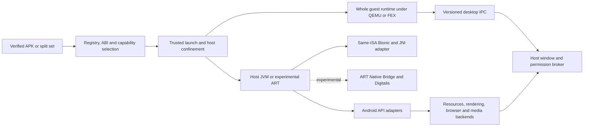

# Historical evidence and research

This file is immutable provenance. Original commands, paths and status claims describe their recorded revision, including the retired JSON tracker; they do not establish current acceptance. Live task status/evidence belongs in the [task files](README.md).

## Source provenance

The Markdown migration read schema 2 of `progress.json`, last updated 2026-10-14. Original tracker SHA-256: `e836d6d791aae21195b7e0ddd6f403406bfbb074f893d7c4e8d7fdcc4c3d8549`.

## Baseline

**Date:** 2026-10-11

Prototype; prior M0-M6 completion labels do not establish production readiness.

### Undated — passed_cached

35/35 build steps; 17 Zig test roots, not 35 individual tests.

**Check:** zig build test --summary all

### Undated — passed

Fresh compilation of 469 Java files; unchecked ArrayAdapter warning.

**Check:** javac --release 17 over framework/**/*.java

### Undated — defects_reproduced

1000ms postDelayed executed in 3ms; main handler callback ran on worker; queue identity unstable; JS 2+2 returned null. Temporary probe, not a committed regression.

**Check:** Temporary Handler/Looper/WebView Java probe

### Undated — defect_reproduced

Repository argument shape returned EINVAL; null/zero VERSION query returned ABI 10. No confinement installed by the probe.

**Check:** Landlock syscall argument probe

### Undated — not_run_missing_dependency

Exited 127: expected /tmp/oracle/dex2jar/dex-tools-v2.4/d2j-smali.sh missing.

**Check:** oracle/diff.sh

### Undated — not_rerun

Historical logs are not current acceptance evidence.

**Check:** Real-app interactive and privileged acceptance


## Earlier milestone reports

Prior M0-M6 claims summarized for provenance, not current acceptance evidence. Full events and reported work remain in progress.json at source_commit. Superseded tracked plans remain in Git history; the untracked M6 fix draft was consolidated into current tasks.

Original source: `progress.json` at commit `9364ad8b41f210f0cef1e07f086b6d8eefb1bcfc`.

### M0: Install pipeline: APK verify, stage, register, uninstall

**Reported status:** complete

isakai install/uninstall a fixture APK; registry round-trips; no Android binaries on disk

### M1: DEX translate + headless run

**Reported status:** complete

Translated fixture logs lifecycle from host JVM; counter persists headless

### M2: Window: native Wayland rendering

**Reported status:** complete

Fixture opens a real xdg_toplevel, draws expected UI, closes cleanly

### M3: Input: keyboard, pointer, resize, focus

**Reported status:** complete

Type into EditText, click Button, survive resize, focus/close correct

### M4: App services: storage, desktop, audio

**Reported status:** complete

3 real OSS apps complete core flows; fixture accepts text and plays sound

### M5: Release: packaging, security, upgrades

**Reported status:** complete

Clean-machine user installs ~25MB, runs APK, upgrades without data loss, uninstalls cleanly; isolation audit passes

### M6: Remaining gaps: native shim, media, WebView, sensors/location, apksig, polkit, privileged E2E

**Reported status:** complete

native x86_64 .so runs with shim, MediaPlayer decodes via ffmpeg, WebView JS bridge, sensors dispatch, multi-signer verify, polkit split dialogs, privileged E2E SKIP/PASS


## App metadata at migration

These are historical labels/workflow descriptions, not maintained app status. Current acceptance evidence is in [C7](C7-acceptance-gate.md).

- **OpenCalc:** recorded status `partial`; original workflow: Calculate, copy result, resize and close.
- **Simple Calculator:** recorded status `pinned_not_verified`; original workflow: Calculate, settings/back, preference persistence across restart.
- **Simple Notes:** recorded status `pinned_not_verified`; original workflow: Create/edit/save Unicode note, restart, verify contents and navigate back.

Original app status meanings:

- `pinned_not_verified`: Pinned candidate without a completed useful workflow.
- `partial`: Some useful behavior has evidence; unresolved failures or missing default-isolation criteria prevent full acceptance.
- `accepted`: The complete pinned workflow has current evidence under default isolation, including persistence and clean shutdown.

## Consolidated research snapshots

The original text below is preserved verbatim inside fenced blocks. Its links and filenames are historical source text, not live navigation.

### Snapshot 1: reports/Isakai compatibility delivery plan.md

**Date:** 2026-10-14

**SHA-256:** `d3ce2eec9f5abc8b4518cb3c740a058469fa560ec4fec6cf02668cf6cdcfb49b`

Immutable research/audit snapshot. Paths, status claims and commands describe the original review; use current plan/tasks/apps/blockers in this file for live decisions.

````text
# Make Isakai Deliver Android Apps Reliably

**Audit date: 14 October 2026. Final scope: an actionable plan, following the request to write all necessary fixes. Audited base: `a354c60d279da75d04cd855b78d7e8fae9897111`; working tree initially clean.** Isakai has a credible host-process prototype, but it does not yet establish general Android application compatibility, native ARM execution, or a complete three-app release gate. The best route to a useful product is to finish that gate, preserve the installer and isolation work, then replace expensive compiler, resource, native-loader and rendering responsibilities through measured upstream experiments. **ATL/ART Standalone/Bionic Translation are the closest reusable architecture; `libandroidfw` is the strongest bounded library candidate.** A competing Robolectric Simulator plus dex2jar experiment is justified, but remains an experimental JVM option. Native x86_64, native AArch64, foreign-ISA execution and 32-bit execution need separate acceptance gates. **Current OpenCalc passes a clean-data useful flow, but retained data produces `Syntax`; investigate that state-dependent failure and repair the acceptance oracle before claiming upgrade/restart reliability.** “Fully compatible with all x64 and ARM mobile applications” cannot be promised: framework behavior, JNI, services, graphics, Google licensing, attestation and protected media remain independent restrictions. The achievable commitment is a growing, reproducible matrix of exact application versions and completed workflows on x86_64 and AArch64 Linux.

This is a dated audit and integration recommendation. **[progress.json](../progress.json) remains the sole live scope, status and evidence tracker.** The accompanying [roadmap.json](../research_notes/Isakai%20compatibility%20delivery%20plan/roadmap.json) is an import proposal containing only planned recommendations; merge accepted entries into that tracker, then stop maintaining status in the proposal. No upstream runtime, browser, renderer or translation engine was built or benchmarked during this audit. No commit or push is part of this work.

## The prototype works, but application acceptance remains open

Evidence needs a clear hierarchy. **E1** means a behavior reproduced against the current local executable or actual library, with retained output. **E2** means a recorded project UI run whose limits are stated; it is stronger than source inspection but is not a fresh rerun of every scenario. **E3** means inspected local code or primary upstream documentation/source. **E4** means a proposed design, effort estimate or unexecuted integration experiment. Historical “done” labels are evidence about their recorded acceptance scope, never proof that later code or a broader feature works. A conflicting current screenshot overrides a historical pass until a fresh run resolves it. An upstream screenshot, successful build or exported symbol does not establish Isakai integration.

| Area | Current finding and grade | Practical implication |
|---|---|---|
| Build | Fresh `zig build` succeeds on Linux x86_64, Zig 0.17 and OpenJDK 27; 491 Java and 21 Zig production source files were counted. E1. | The checkout builds on this host. Counts do not measure Android API fidelity; ARM64 and clean package installation remain separate evidence. |
| Artifact identity | SHA-256 values of all three cached pinned APKs match `progress.json`. E1. | The observed failures concern known inputs, rather than guessed latest app versions. |
| OpenCalc 3.2.1 | Current clean-install private-Sway rerun passes visible `46`, clipboard `46`, resize, 31 seconds and exit zero. Existing-data rerun fails with `Syntax` and clipboard `12+34`. E1; cause unknown. | Clean-state useful flow is proved; retained-state/restart/upgrade reliability is unresolved. Repair stale-history result assertions. Both runs use `ISAKAI_NO_PRIVILEGE=1`. |
| Simple Calculator 5.12.0 | Calculation works; settings opens but Compose content remains blank. No verified preference/restart/back sequence. E2. | Loading an Activity and Compose classes is insufficient; the composition/scheduling path is a release blocker. |
| Simple Notes 6.17.0 | Launch/render progress exists; useful Unicode edit/save/restart/back remains unproved. The driver also omits full restart/reopen assertions. E2/E3. | A visible editor, stored marker or headless text injection is insufficient persistence evidence. |
| Scheduling/navigation | Queued, thread-owned Handler/Looper exists; C3 is done for its defined subset. C4 navigation is in progress. E2/E3. | Do not redo the queue from stale descriptions. Verify missing barriers, frame timing, lifecycle and coroutine integration where apps expose gaps. |
| Isolation | R1–R4 contain earlier privileged fixture evidence for lifetime, UID/GID, NNP, seccomp, namespace/filesystem restrictions and cleanup. E2. | Preserve those contracts. The current privileged harness references deleted `verify-isakai/RuntimeProbe.java`, so the gate cannot presently reproduce even with privileges. It does not establish current default-confined acceptance for the three apps. |
| Verification/build CI | Project explicitly uses UI-only verification; automated suites were removed. Hosted CI builds and compiles framework classes. E3. | CI green currently means compilation. Required release flows need a reproducible private compositor and an authorized privileged runner. |
| Native/ARM | Installer/launcher still select `lib/x86_64`; confinement pins x86_64 audit architecture; packages advertise x86_64/amd64. Narrow ELF header/path rejection was added during audit; final CLI verification pending. E3. | Current source is not an ARM64 host or general native-APK support claim. |

The pinned SHA-256 values are OpenCalc `43b6befd1fecc686ba1611bbda18896cc26d966047e788be995def569a4510f3`, Calculator `092629deaeaaea824dbf0cd824989e80b498b1fa07ad5b4c3e744fc64ce5ab2f`, and Notes `d3064ad405e3488d0b4676dd547d9ea2d337fcc5def2a91dd09974ece50b0575`. Relevant OpenCalc artifacts include `opencalc-02-result.png`, `opencalc-04-shrunk.png`, `opencalc-05-grown.png` and its Sway log under `.cache/isakai/evidence/`. The app-level `pinned_not_verified` labels and later task evidence conflict; reconcile them as clean-state accepted, retained-state failure unresolved, rather than copying historical completion claims. C7 remains open. Earlier suite commands and deleted paths in historical entries should remain clearly historical. [README](../README.md), [tracker](../progress.json), [verification policy](../verify-isakai/SKILL.md).

OpenCalc needs an independent acceptance-oracle repair: clear or uniquely identify input state/history, assert the displayed result for the current expression, verify a newly committed history entry and copied result, and reject `Syntax` even when an older history contains `46`. The warm rerun copied the expression `12+34`; this cannot count as copied result `46`. A subsequent fresh-install/clean-data rerun passed the full workflow: inspected visible `46`, touch clipboard `46`, `640x800 → 480x600 → 720x860`, 31 seconds and clean exit zero. Artifacts are under `.cache/isakai/evidence/audit-20261014/fresh-ui/`; its work tree is `.cache/isakai/evidence/audit-20261014/opencalc-fresh`. The prior `opencalc10` state still fails. Compare its persisted preferences/history and settings with fresh data, retain both reproducible inputs, and prove migration/restart behavior before closing that issue. No default-privileged or ARM claim follows.

The Notes harness needs a concrete repair before its own green result can close C7. `verify-isakai/sway_backend/flows_notes.py` checks a saved marker and sets `returned_from_editor=True` after Escape without proving the list UI; it does not close, restart and reopen the note. Extend it to assert the visible list, clean close, fresh process, reopened note and exact Unicode contents before claiming round-trip acceptance. This is a verification gap independent of any app implementation defect.

The immediate Calculator diagnosis deserves restraint. The recorded SettingsActivity attaches a full-size Compose owner, `setContent` executes and the composition gate is set, but no composed children appear after roughly 70 seconds; the captured thread dump shows no worker/recomposer activity. This narrows the investigation to startup/context/dispatch rather than proving a particular root cause. Trace the obfuscated recomposer launch, inspect staged `META-INF/services` resources and Kotlin coroutine service discovery, and establish whether `Dispatchers.Main` binds to the owning Looper. Then verify frame clock, invalidation, lifecycle cancellation and visible settings toggles. Do not replace Compose with success-shaped stubs or declare a dispatcher fix before the exact APK proves it. Android Compose explicitly has separate composition, layout and drawing phases. ([Compose phases](https://developer.android.com/develop/ui/compose/phases))

Five diagnostic CLI APK variants also confirmed that the original directory-only native gate accepted mislabeled ARM ELF, truncated/non-ELF content and nested x86_64 paths. A narrow selected-slice path/ELF-header validator was subsequently added with `InvalidNativeLibrary`/`NativeAbiMismatch` failures; its final CLI confirmation was pending at this snapshot. Full host ABI selection, dependency closure, loader/JNI and runtime-loaded code remain N2/N6 work.

Several bounded defects were found while auditing. The xkb path called real libxkbcommon functions before state/keymap initialization; four null operations reproduced crashes in a temporary wrapper. Wayland layout `group` also belongs in the locked-layout parameter, and saved modifiers must be reapplied after keymap installation. The property shim accepted an oversized default: a real-DSO caller returned 120 and overwrote a canary at byte 92; a callback reentering `property_get` hung while `property_list` held its lock. Those findings justify targeted guards, a 91-byte-plus-NUL property bound and a snapshot released before callbacks. The Arch package also retained a `check()` hook invoking the removed `make test` target. Fix validation and remaining limits are recorded separately below; none of these repairs establishes general Bionic compatibility. ([libxkbcommon Wayland example](https://raw.githubusercontent.com/xkbcommon/libxkbcommon/master/tools/interactive-wayland.c), [Android property contract](https://android.googlesource.com/platform/bionic/+/refs/tags/android-15.0.0_r1/libc/include/sys/system_properties.h))

Documentation is another concrete fix. `docs/ARCHITECTURE.md` and host descriptions still describe immediate Handler calls, bitmap-only text or default synthetic providers. Actual code has a queue, Java2D-backed text, and unavailable sensors/location unless explicit fake test switches are enabled. Update those descriptions and the reuse assessment's four already-corrected shim signatures. An accurate capability catalog should distinguish implemented behavior, partial adapters, unavailable providers and unsupported APIs; class presence must never serve as a compatibility score.

## CPU compatibility requires three distinct execution contracts

**DEX bytecode is not tied to an APK's ARM or x86 native slice.** A bytecode-only APK can in principle run on either host through a suitable runtime, but still depends on DEX features, libcore, resources and framework behavior. Host JNI bridges remain architecture-specific binaries. Once the APK includes native code, matching instruction set is only the first check: Android ABI also includes calling conventions, layout, TLS, dynamic linker behavior and platform libraries. For example, Android ARMv7 uses softfp conventions, while Android ARM64 reserves x18. ([NDK ABI guide](https://developer.android.com/ndk/guides/abis), [DEX specification](https://source.android.com/docs/core/runtime/dex-format))

| Linux host | APK native ABI | Eventual execution contract | Current support and independent gate |
|---|---|---|---|
| x86_64 | None | Host x86_64 JVM or selected DEX runtime | Existing route; only accepted workflows count. |
| AArch64 | None | Host AArch64 JVM/runtime plus rebuilt Isakai bridges | Needs real ARM64 hardware, packaging and confinement verification. |
| x86_64 | x86_64 | Same-ISA Bionic loader plus runtime JNI adapter | Current symbol subset is insufficient; prove Android-NDK-built libraries. |
| AArch64 | arm64-v8a | Same-ISA ARM64 Bionic/JNI route | Installer, paths, TLS and seccomp must change and pass on ARM64. |
| x86_64 | arm64-v8a only | qemu-aarch64 whole guest process first; mixed-ISA engine later | No current route. Requires matching guest runtime and bridge dependencies. |
| AArch64 | x86_64 only | Whole x86_64 process through QEMU; FEX accelerator, Box64 comparator | Reverse direction from ARM-on-x86; Bionic/JNI still required inside guest. |
| x86_64 | x86 | Separate 32-bit JVM/ART and libraries, native IA32 where available or qemu-i386 | A 64-bit JVM cannot load a 32-bit DSO. Independent i386 policy. |
| AArch64 | armeabi-v7a | Separate ARM32 runtime where AArch32 exists, otherwise qemu-arm | ARM64 does not guarantee ARM32 hardware/kernel/userspace. |
| x86_64 | armeabi-v7a only | qemu-arm whole 32-bit guest | Independent calling convention, dependencies, runtime and confinement. |
| AArch64 | x86 only | FEX whole x86 process or qemu-i386 | Box86 requires a 32-bit host subsystem; unsuitable for 64-bit-only hosts. |
| Either | Several slices | Select one complete compatible ABI; prefer native ISA and bitness | Never combine dependent libraries from different ABI directories. |

The first contract is **same-ISA Android/Bionic loading**. Isakai's current preload exports selected Android symbols, while `android_dlopen_ext` delegates to the host loader and ignores extension information. Bionic includes libc, libm, libdl and its Android dynamic linker; glibc is not a behavioral replacement. Bionic Translation already tackles loader, libc/pthread and TLS boundaries, making it a better experiment than expanding interposition indefinitely. However, `bionic_dlopen` alone does not register a library with HotSpot's native-method resolver. The adapter must handle symbol lookup, `JNI_OnLoad`, static JNI names, `RegisterNatives`, classloader ownership, callbacks, native-created thread attachment, exceptions, references/GC and lifetime. ART Standalone contains relevant runtime integration already. ([Bionic overview](https://android.googlesource.com/platform/bionic/+/refs/heads/main/README.md), [Bionic Translation](https://gitlab.com/android_translation_layer/bionic_translation/-/blob/6253dec7f24a57a94039a088cb436d880e92e3be/README.md), [ART JNI loader](https://gitlab.com/android_translation_layer/art_standalone/-/blob/66a5d9079b159e9c5819bfeef4a6fff6a5f32719/art/runtime/jni/java_vm_ext.cc))

The second contract is a **whole guest userspace process**. A guest JVM/ART, app libraries and guest-built Isakai bridge share ISA and bitness under QEMU user mode. A native supervisor brokers pixels, input, audio and permissions over versioned IPC/shared buffers. No host JNI pointer, `JNIEnv` table or function pointer crosses that boundary. This stays an ordinary Linux process without booting an Android OS or kernel. QEMU documents instruction, syscall and signal translation; it still needs the guest interpreter and libraries, and its limitations must be measured against JVM threads/signals and the host sandbox. With QEMU or FEX, seccomp evaluates syscalls made by the translator's **host executable**, rather than guest syscall numbers; direct i386/native processes need their own architecture policies. ([QEMU user mode](https://www.qemu.org/docs/master/user/main.html))

The third contract is **mixed-ISA JNI inside a host runtime**, the most difficult optimization. Guest ARM functions need signature-aware trampolines into host Java/native callbacks, guest loader and TLS, thread transitions, signals and safe pointer ownership. AOSP Native Bridge provides an interface, not the translator itself; linking it into HotSpot does not add ART's runtime hooks. Digitalis is a relevant public ARM64-to-x86_64 Berberis fork, but its shipped integration targets an AOSP host, with Android properties, fdsan, linker namespaces and JNI proxies. Evaluate it after a whole-guest correctness baseline, or stop if adopting it makes Android system services mandatory. ([Native Bridge README](https://android.googlesource.com/platform/art/+/refs/heads/main/libnativebridge/README.md), [interface](https://android.googlesource.com/platform/art/+/302ef33c94/libnativebridge/include/nativebridge/native_bridge.h), [Digitalis implementation](https://github.com/DigitalisX64/platform_frameworks_libs_binary_translation/blob/android-latest-release/native_bridge/native_bridge.cc))

The architecture should make these choices explicit:



The deployment rule stays **no Android OS image, Android system container or kernel Binder dependency**. A mount namespace that confines a host JVM is compatible with that rule; it is not an Android system container. Java Binder shells and libbinder/libgbinder do not supply ActivityManager, PackageManager, media services or Google services. Waydroid's full Android container, archived Anbox and Microdroid's protected VM are valuable reference/oracle environments, but changing to them would change the product architecture. ([Waydroid](https://waydro.id/), [Anbox archive](https://github.com/anbox/anbox), [Microdroid architecture](https://source.android.com/docs/core/virtualization/microdroid))

## Reuse deep implementations through narrow, owned adapters

The research supports selective reuse, rather than a language rewrite or wholesale classpath merge. Keep Zig installation, registry, signer continuity, process supervision, per-app data ownership and isolation. Keep current SQLite and working desktop/audio paths until measured limits justify replacement. Give each Android-facing class one owner; placing two full `android.*` frameworks on a classpath creates incompatible ownership and behavior. Every candidate below is E3 source evidence and an E4 adoption recommendation, not a built Isakai dependency.

| Component | Reuse recommendation and boundary | Main limit and promotion gate |
|---|---|---|
| ATL | Port focused pure-Java/AOSP algorithms and study its native assets/window/service adapters. | GTK/GDK/GLib object ownership differs from Isakai's raw Wayland SHM path; its README acknowledges missing APIs and sandbox work. No wholesale replacement. |
| ART Standalone | Bounded alternative DEX/libcore/JNI backend; study existing Bionic and Native Bridge integration. | Current framework uses Java2D/AWT, host image APIs and `Path.of`. Porting it requires API/build/render adaptation, rather than changing `java` to `dalvikvm`. |
| `libandroidfw` | JNI/C adapter below Resources/AssetManager for configuration selection, themes, assets and binary XML. | Native dependencies and handle ownership; preserve verified original APKs and define framework/system resources. Compare locale/density/night/SDK selection. |
| Robolectric 4.17 + Simulator | Compare instrumented Android implementation JAR/shadows with current framework; retain as oracle if unsuitable. | Simulator is explicitly experimental and documented for source/test apps, not arbitrary installed APKs. Must prove dex2jar APK loading, Linux ARM64 binaries and isolation. |
| dex2jar 2.4 | Compare install-time DEX conversion against current translator; include tool/input hashes in cache identity. | Compiler substitution does not provide Android framework or native ABI support. Verify complete multidex output and real workflows. |
| Bionic Translation | Preferred same-ISA loader/wrapper spike; reuse upstream fixture coverage. | Needs main-executable/TLS work and runtime JNI resolution; non-null `android_dlextinfo` remains unimplemented upstream. |
| [libhybris](https://github.com/libhybris/libhybris) | Targeted wrapper/loader reference if an actual app dependency fits. | Hardware-adaptation focus, per-driver bridges and Bionic assumptions; neither CPU translator nor full app framework. |
| QEMU user mode | Whole-guest correctness baseline in both CPU directions, with ARM32 separate. | Performance, guest runtime footprint, signals, clone behavior and sandbox integration require measurements. |
| [FEX](https://github.com/FEX-Emu/FEX/blob/main/Readme.md) / [Box64](https://github.com/ptitSeb/box64/blob/main/README.md) | Compare x86/x86_64 processes on ARM64; FEX first, Box64 secondary. | Wrong direction for ARM APKs on x86_64. Host API wrappers do not implement Bionic/Android. |
| [Digitalis](https://github.com/DigitalisX64/digitalis/tree/android-latest-release) / [upstream Berberis](https://android.googlesource.com/platform/frameworks/libs/binary_translation/+/refs/heads/main/README.md) | Time-box correct-direction Digitalis mixed-ISA experiment; reuse public proxy/JNI patterns. | Public upstream Berberis README documents RISC-V64 guest support; Digitalis adds ARM64. Android-host integration is not a validated glibc/HotSpot plugin. |
| AOSP [apksig](https://android.googlesource.com/platform/tools/apksig/+/refs/heads/main/README.md) / [bundletool](https://developer.android.com/tools/bundletool) | Public Java verifier and existing split-selection tooling; keep registry/update policy in Isakai. | Atomic package/version/signer/resource/classpath validation remains custom. Preserve signatures; never silently debug-sign someone else's bundle. |
| AOSP/Layoutlib + Skia | Port selected host framework delegates; put CPU SkSurface behind Canvas/Paint/Bitmap before GPU. | Layoutlib is a preview system; real lifecycle/input/Compose are separate. Use shared shaping/metrics for measure, draw and selection. |
| Mesa / ANGLE | Packaged EGL/GLES/Vulkan backend after Android native-window ownership exists. | Current wire IDs are not `wl_display*`, `wl_surface*` or EGL handles. Establish libwayland/GDK object boundary first. |
| CEF/JCEF or WebKitGTK | Real WebView backend behind Android API adapter and per-app browser process contract. | JavaScript bridge, origin policy, profile isolation, callbacks and browser sandbox remain substantial; CEF ARM64 availability unverified here. |
| GStreamer / FFmpeg / PipeWire | Asynchronous bounded streaming/decoding and authorized host audio/video endpoints. | Decoder success is not MediaCodec or DRM compatibility. Keep per-API state/callback semantics and codec license review. |
| Portals / optional sandbox tools | Broker FileChooser/OpenURI/notifications/location/camera using per-app identity and authorized fds. | Bubblewrap supplies plumbing, not policy; broad session-bus access or disabled browser sandbox fails the boundary. |

ATL's source uses ART plus Bionic Translation, native libandroid adapters and GTK; it is the closest useful reference to Isakai's premise. Its resource C API exposes APK loading, configuration, lookup, reference/theme/style and XML functions. Those can be evaluated independently of replacing DEX execution. Current `Resources.lookupDepth` prefers a default or first type chunk rather than implementing complete Android best-match resolution; `src/arsc.zig` adds a second parser. Replace the deep selection engine once, with a compatibility facade for the label reader, instead of accumulating two implementations. APK-backed assets also require preserving an immutable verified archive or proving a staged-assets adapter, including native fd/offset semantics. ([ATL build](https://gitlab.com/android_translation_layer/android_translation_layer/-/blob/07c34abad5d29864998ed7c7cfc6c80d0765b9df/meson.build), [resource C API](https://gitlab.com/android_translation_layer/art_standalone/-/blob/66a5d9079b159e9c5819bfeef4a6fff6a5f32719/libandroidfw/include/androidfw/androidfw_c_api.h))

ART and Robolectric answer different costs. ART removes bespoke DEX execution and brings Android-oriented JNI/libcore integration, but forces a host-only API/render audit. Robolectric is closer to the present JVM and supplies actual Android implementation plus instrumentation/shadows, yet its simulator remains proof of concept. Loading `android-all.jar` beside existing classes does not reproduce Robolectric initialization or native/service handling. Run a 2–5 engineer-day ART build/DEX/JNI spike and a 5–10 engineer-day Robolectric source-app-then-same-APK spike; choose one strategic backend from actual fidelity, maintenance, memory/startup and confinement results. Preserve the existing JVM path until the challenger completes the same workflow. ([ART Standalone README](https://gitlab.com/android_translation_layer/art_standalone/-/blob/66a5d9079b159e9c5819bfeef4a6fff6a5f32719/README.md), [Robolectric architecture](https://robolectric.org/architecture/), [Simulator](https://robolectric.org/simulator/), [dex2jar release](https://github.com/pxb1988/dex2jar/releases/tag/v2.4))

For rendering, reuse Skia and established Unicode libraries instead of expanding independent raster, shaping and line-breaking engines. A small C ABI can wrap SkCanvas/SkSurface while existing Java APIs retain ownership. Start with CPU buffers and unify measurement, drawing, cursor placement, selection and fallback. HarfBuzz, FreeType and ICU are candidate constituents; Arabic, Indic, Tibetan, bidi, combining sequences and emoji need visible corpus coverage. GPU work requires Android `ANativeWindow`, surface/configuration/lifetime and synchronization semantics; linking EGL alone cannot supply them. ([Skia documentation](https://skia.org/docs/), [HarfBuzz](https://harfbuzz.github.io/), [Mesa EGL](https://docs.mesa3d.org/egl.html), [ANGLE](https://github.com/google/angle/blob/main/README.md))

F2 should embed an actual browser. CEF offers offscreen rendering and JCEF integration references; WebKitGTK offers maintained distro integration and script-message APIs. Prototype the required APK page, JavaScript calls and lifecycle before choosing. ATL's WebView is a useful host-backend reference but its inspected `evaluateJavascript` is empty and its bridge contains an app-specific shortcut. F1 should adopt bounded asynchronous media pipelines, not whole-file decode as the general path. F4 should retain unavailable-provider behavior until a brokered real provider exists; fabricated coordinates remain test-only. ([CEF](https://github.com/chromiumembedded/cef/blob/master/README.md), [WebKitGTK bridge](https://webkitgtk.org/reference/webkitgtk/stable/class.UserContentManager.html), [ATL WebView](https://gitlab.com/android_translation_layer/android_translation_layer/-/blob/07c34abad5d29864998ed7c7cfc6c80d0765b9df/src/api-impl/android/webkit/WebView.java), [GStreamer playbin3](https://gstreamer.freedesktop.org/documentation/playback/playbin3.html), [portal Camera](https://flatpak.github.io/xdg-desktop-portal/docs/doc-org.freedesktop.portal.Camera.html))

## Each refactor needs a motivating failure and a stop gate

The following fixes retain existing task ownership. Their estimates are **planning ranges for one experienced engineer**, excluding access delays and major newly discovered dependencies; they are not sourced facts or delivery promises. Current UI-only policy stays intact: use real fixture/pinned APK windows and retain native diagnostics/screenshots as evidence, rather than adding a new automated suite. Temporary ABI probes help diagnose a boundary, but promotion still requires an affected visible app flow under default isolation.

| Existing owner | Concrete change and relevant files | Acceptance and stop gate | Estimate |
|---|---|---|---|
| C6/C7 | First repair/re-run OpenCalc's current-expression oracle and investigate the visible Syntax regression on fresh state. Trace Calculator coroutine service discovery and dispatcher; preserve needed APK Java resources in `src/install.zig`/`src/launch.zig`; adapt main scheduling in Handler/Looper/Choreographer only where demonstrated. | Fresh OpenCalc calculates and copies its current result; same pinned Calculator APK shows actual settings, toggles a preference, returns via back, restarts with value retained and stays responsive >30 seconds. Stop broader Compose claims if only this screen passes. | 3–10 days investigation; 2–6 weeks if deeper Android Compose owner semantics emerge. |
| C4/C5/C7 | Extend `flows_notes.py` with visible list/restart/reopen/content assertions, then drive Unicode/save/back; fix measured EditText/layout/text/storage/lifecycle paths. | Exact persisted Unicode content, cursor/selection behavior, no overlap after resize, clean restart and lifecycle. Retain before/after screenshots and saved state. | 1–3 weeks, uncertainty dominated by undiscovered app paths. |
| C7/R4 | Restore a tracked app-side isolation fixture replacing the deleted RuntimeProbe.java reference, prove the gate fails for real isolation errors, then rerun all three workflows using default per-app UID/confinement, signed APK policy and clean installs/upgrades. | Three useful flows, persistence, >30 seconds, exit zero, no leaked children/UIDs; changed signer rejected; rollback leaves prior app/data usable. Any isolation bypass fails release. | 3–7 days once app flows and runner exist. |
| C6, bounded repair | Guard null xkb map/state; correct locked-layout group and replay modifiers in `src/bridge/xkb.zig`, `window.zig`. | No crash before keymap, replacement/reordered events; Shift/Caps/nonzero group behavior; visible input/resize/close unaffected. A wrapper-only pass is provisional. | Applied repair; final UI status below. |
| F5, bounded repair | Bound defaults and release property lock before callbacks in `src/native/bionic_shim.zig`. | 91+NUL buffer canary intact; reentrant callback returns; actual app launches unaffected. Does not claim general ABI compatibility. | Applied repair; final status below. |
| Q1/R3 | Remove obsolete Arch `check()`; make compositor startup tracked/configurable; update stale architecture, host and reuse prose. | Clean staging/build, private UI flow from fresh checkout, no hardcoded `/tmp` instance or untracked fixture dependency. Package build alone is not UI acceptance. | Hook removal applied; reproducibility 3–7 days. |
| F1 | Introduce asynchronous bounded playback beneath MediaPlayer/IsakaiMedia using GStreamer or FFmpeg plus host audio. | 30-minute stream, pause/seek/loop/EOS/errors, timeout/cancel, bounded memory and confined access. Stop “MediaCodec supported” unless its own contract passes. | 3–6 weeks for a selected audio/video app. |
| F2 | BrowserBackend beneath `framework/android/webkit`, process/profile ownership in launch and broker. | Offline/HTTPS page, general JS, cookie restart, origin-safe bridge, IME/input, child crash recovery; browser sandbox enabled. | 4–8 weeks pilot, larger for broad Android WebView parity. |
| F4 | Real provider discovery through `IsakaiSensor`, `IsakaiLocation` and authenticated desktop broker. | Denial/unavailable/cancellation and real host values; no raw user session-bus or broad device grants. | 1–3 weeks per selected provider family. |

The proposed new work below is detailed in `roadmap.json`. **N IDs are recommendations, not started work.** They extend existing goals without renaming C1–C7, R1–R4, Q1–Q3 or F1–F5. In particular N7–N10/N17 decompose F3's later ABI goal; N13/N15 provide explicit F5 capabilities. Do not promote every experimental task at once.

| Proposal | Implementation and dependencies | Pass gate / stop decision | Planning range |
|---|---|---|---|
| N1: reproducible release evidence | Track compositor/vinput and missing isolation fixture; fix stale-history and Notes restart/back assertions; add provenance and teardown. Complements Q1/R4. | Fresh checkout repeats flows and preserves immutable per-run evidence; no cached private Sway required. | 3–7 days. |
| N2: ABI/ELF/dependency diagnostics | Typed host vs APK selection in installer/launcher; inspect ELF class/machine/endian, dependencies, symbols/relocations/TLS; improve compat-report. | Wrong directory/machine, mixed closure and absent backend fail clearly before launch; dynamic loading uncertainty reported. | 3–7 days inventory; 1–2 weeks enforcing selection. |
| N3: runtime execution interface | Preparation/cache key, capabilities, trusted executable/args, runtime paths, native loader and lifecycle; keep helper allowlist narrow. Depends N2. | Current JVM produces identical accepted workflows through interface; no arbitrary executable command runner. | 1–2 weeks. |
| N4: pinned reuse ledger | Source/license/patch/build manifest, local-prefix recipes and ownership. | Exact reproducible dependency inputs; missing license/target evidence blocks distribution. | 2–5 days initial; recurring maintenance. |
| N5: resource engine | `libandroidfw` adapter beneath existing Resources/AssetManager, immutable APK ownership and configuration mapping. N3/N4. | Locale/density/night/theme/XML/assets agree with reference Android; current parser remains fallback until parity. | 2–4 weeks pilot. |
| N6: same-ISA Bionic/JNI | Load and lookup via selected runtime adapter, with NDK-built static/registered JNI, callbacks/threads/GC/TLS/C++ dependencies. N3/N4. | Real x86_64 APK workflow; corruption/hang or private-HotSpot dependency blocks promotion. | 3–6 weeks pilot. |
| N7: native ARM64 host | Replace x86 assumptions in ABI, build, seccomp, packages and paths; verify page sizes/x18/TLS. N2/N3/N6. | Same corpus/three useful workflows on physical ARM64 with confinement; compile-only is insufficient. | 2–4 weeks after loader pilot. |
| N8: whole-guest QEMU | Guest runtime/bridge artifacts plus versioned host IPC; trusted guest manifest and sanitized environment. N1/N3/N6. | ARM64-only fixture and real app action on x86_64; pointers remain inside guest; cleanup/isolation pass. | 2–4 weeks pilot. |
| N9: ARM64-host x86 acceleration | Same guest process boundary with FEX, QEMU comparator, optional Box64. N7/N8. | Identical behavior and measured improvement on target hardware; reject app-specific wrapper hacks as default. | 1–3 weeks. |
| N10: Digitalis experiment | Pin engine/manifest, prove upstream fixture, then inventory Linux/ART/JNI/namespace portability. N4/N8. | Intended Isakai runtime completes callbacks, threads, GC, signals and real action; no mandatory full Android image. | 1–2 weeks feasibility; 4–12+ weeks only after pass. |
| N11: ART versus JVM | Build pinned standalone runtime, minimal DEX/NDK app and host-API audit; compare accepted app with JVM. N3/N4. | Behavior/libcore/native/isolation and measured cost justify one strategic backend; build success alone fails gate. | 2–5 days spike; migration can add 1–3 months. |
| N12: Robolectric/dex2jar comparison | Official simulator source app, same APK conversion and resource/classloader/shadow adaptation. N3/N4. | Same useful task/restart under confinement, including ARM64 feasibility; large internals fork stops production adoption. | 5–10 days spike; 4–8 weeks limited pilot if viable. |
| N13: verifier and atomic splits | Public apksig adapter plus split targeting, consistent signer/package/version, rollback and ordered resources/multidex. N2/N4/N5. | Valid signature/update/rotation cases and split app flow; unsigned/mismatched/partial set leaves installed state intact. | 2–4 weeks. |
| N14: render/text engine | CPU Skia facade and shared shaping/hit-testing; audit Layoutlib delegates. N3/N4. | Real Unicode/input/selection/resizing corpus on both hosts with bounded caches; no preview-only dependency smuggled in. | 3–6 weeks pilot. |
| N15: stable NDK surfaces/GPU | Native asset/window ownership, Wayland proxy or alternate GDK backend, Mesa EGL/GLES; Vulkan later. N5/N6/N14. | NDK app renders/input/resizes/context-loss under confinement on x86 and ARM GPU; linking EGL alone insufficient. | 4–8 weeks pilot. |
| N16: compatibility/performance matrix | Versioned corpus, host/APK/runtime identity, actions, screenshots, denial logs and resource metrics. N1/N2. | Public support claims trace to immutable real runs; launch, JNI and workflow results distinct. | 3–7 days initial; each release. |
| N17: independent 32-bit policy | Demand-led ARMv7/x86 runtime, guest libraries, float/varargs/pointer checks and actual syscall architecture policy. N6/N8/N16. | Separate 32-bit fixture and real app; unsupported hardware/kernel/runtime is explicit unavailable. | 2–6 additional weeks per selected route. |

The first refactor should expose boundaries, not move files for appearance. `src/launch.zig` should consume an already validated runtime/ABI selection; `uid_helper.zig` should allow only trusted backend entrypoints and backend-specific read paths. Resources keep the public Java facade while a native engine owns handles. Rendering, browser and media each need their own callback/lifetime contract. Guest desktop integration uses IPC. Keep capability failures explicit and avoid falling back to another runtime after partial execution, which can corrupt persistent state or hide the actual failure.

## Ship a measured support promise with controlled maintenance

A feasible sequence begins with **weeks 1–3 for honest acceptance oracles, missing privileged fixture, current app blockers and reproducible evidence**, then a 1–2-week bounded reuse decision period. N2/N3/N4 and resource/native pilots can follow in delivery slices; native ARM64 comes after the same-ISA contract is meaningful, and foreign ISA follows a guest boundary. For a single maintainer, a narrow, well-proven x86_64 plus native ARM64 utility release is a **multi-month effort**, with an illustrative 3–6-month planning envelope if the small runtime spikes pass. This is not a commitment: deeper Compose, ART migration, graphics or unavailable ARM hardware can expand it substantially. ARM64-on-x86 and reverse-direction acceleration add their own pilot budgets; broad 32-bit/native games/WebView/media coverage is later. With two specialists, runtime research and app verification can overlap, but do not maintain ART and Robolectric production forks simultaneously before choosing.

Use four release decisions. First, all current pinned tasks pass under default isolation with clean restart and signer/upgrade behavior. Second, both native host architectures reproduce those exact tasks and the same-ISA NDK corpus. Third, a foreign-ISA backend passes a separately named corpus and publishes overhead/limitations. Fourth, new capability families enter only with motivating apps and maintenance owners. Measure cold/warm launch, translation time/cache hit, RSS/PSS, idle CPU, frame-time distribution, input latency, fd/thread counts, child cleanup and installed/download size. Initially publish measurements, then choose realistic budgets; neither upstream demos nor this audit provides performance numbers. A mixed-ISA optimization must beat the whole-guest baseline reproducibly on useful work, not just start an ELF.

Product success means retained useful workflows, not source count. Track supported app versions per host/APK ABI, percentage of previously supported flows that still pass, blocker diagnosis turnaround, reproducibility from clean machines, security-update lag and upstream patch burden. A small weekly expansion into ordinary Kotlin/Java utilities gives clearer value than hundreds of silent API shells. Add Compose-heavy, browser and native media apps as explicit capability cohorts. “Installed,” “ELF compatible,” “loader/JNI verified,” “window mapped” and “useful task accepted” must remain separate results.

Pin the initial research candidates before building: ATL `07c34abad5d29864998ed7c7cfc6c80d0765b9df`, ART Standalone `66a5d9079b159e9c5819bfeef4a6fff6a5f32719`, and the previously inspected Bionic Translation `6253dec7f24a57a94039a088cb436d880e92e3be` are source-review starting points, not a claim of newest or compatible combined builds. Robolectric `4.17` and dex2jar `v2.4` were verified release tags; dex2jar's release date is 3 October **2023**. Capture immutable Digitalis/manifest/subproject hashes before its experiment. The discovered `killerdevildog/android_translation_layer` unified CMake wrapper at `4ed75fbf108c5593a65b6ee1295d5445c935aaf4` is real, but hardcodes an amd64 JDK, copies lib64, masks failures with `|| true` and assumes external sources. Reuse its build ordering only after correcting portability/failure propagation; prefer official Meson/local-prefix recipes initially. ([ATL build guide](https://gitlab.com/android_translation_layer/android_translation_layer/-/blob/07c34abad5d29864998ed7c7cfc6c80d0765b9df/doc/Build.md), [CMake wrapper](https://github.com/killerdevildog/android_translation_layer/blob/4ed75fbf108c5593a65b6ee1295d5445c935aaf4/CMakeLists.txt), [Robolectric release](https://github.com/robolectric/robolectric/releases/tag/robolectric-4.17))

Licenses need component-level decisions. Isakai is GPL-3.0-or-later; ATL has GPLv3 plus retained AOSP notices. ART/Bionic contain mixed files/dependencies; an inspected Apache notice cannot license their whole tree. apksig, Robolectric, dex2jar, bundletool and Digitalis have Apache-2.0 evidence for their reviewed entry components; verify every imported subtree. QEMU is GPLv2; FEX/Box64 core MIT; libhybris is mixed. Skia/ANGLE/CEF principal code uses BSD-style terms, HarfBuzz principally Old MIT, FreeType FTL or GPLv2, ICU Unicode License V3 plus notices, WebKit mixed LGPL/BSD. GStreamer core is LGPL-2.1; FFmpeg depends on enabled components and build flags. Record source/license hashes, build flags, transitive notices, patches, source-offer requirements and an update owner. No proprietary Houdini/libndk_translation redistribution permission was established; a mirror download is not product permission. ([AOSP licensing](https://source.android.com/docs/setup/contribute/licenses), [Skia license](https://github.com/google/skia/blob/main/LICENSE), [WebKit licensing](https://webkit.org/licensing-webkit/), [FFmpeg legal](https://ffmpeg.org/legal.html), [QEMU documentation](https://www.qemu.org/docs/master/user/main.html))

Scope excludes any universal banking, anti-cheat, protected streaming or Google-service promise. Android compatibility formally involves CDD/CTS, and Google licensing is separate. Play Integrity device verdicts rely on certified Android and hardware-backed conditions; a Linux compatibility process should not fabricate attestation. A codec engine does not supply DRM plugins/device provisioning. Network/service authentication, proprietary hardware APIs, vendor camera stacks and downloaded native code remain app-specific unknowns. State these in the matrix before users invest in unsupported applications. ([Android compatibility](https://source.android.com/docs/compatibility/overview), [Play Integrity verdicts](https://developer.android.com/google/play/integrity/verdicts), [Android DRM architecture](https://source.android.com/docs/core/media/drm))

The next three execution commands, from the repository root, are below. They exercise the existing path; they do not build the proposed upstream stack. The final command currently requires the private Sway/vinput fixture and installed pinned Calculator work tree, so N1 must make that setup portable; the report command needs only the pinned APK and built framework. Record the exact environment and retain a separate evidence directory per run. A Calculator failure is useful evidence for C6, not a successful release gate; final default-privileged reruns follow after these development diagnoses.

```sh
zig build
python3 tools/compat-report.py .cache/isakai/apks/calculator-fdroid-release.apk --output /tmp/isakai-calculator-compat.json
python3 verify-isakai/sway-flow.py calculator --work .cache/isakai/recheck/calculator2 --evidence /tmp/isakai-calculator-audit-ui
```

**Audit repair validation:** ReleaseSafe build passes. The four real libxkbcommon null calls that crashed before now exit zero and return empty text/modifiers/repeat. The actual property DSO now returns 91 plus NUL with its canary intact; a reentrant list callback reads/writes and returns. These are E1 narrow probe results, not native-APK or full UI acceptance. The obsolete Arch check hook is removed. `tools/compat-report.py` now adds a bounded 64-byte ELF-header inventory (class, machine, endianness, type, header/version validity and ABI-directory consistency) and corrects default sensor/location descriptions. This is diagnostic inventory only: installer selection, dependency closure, symbol resolution, JNI behavior and backend support are not thereby validated. The xkb/property/package/diagnostic and narrow installer changes are applied and uncommitted. The installer path/header gate awaits final CLI confirmation. Current OpenCalc passes the complete clean-state same-UID UI flow but fails retained-state result/copy; the state-dependent cause is unresolved. Full affected-window/modifier behavior and default-isolation acceptance must be recorded before describing the repairs as fully UI-verified. The underlying general native/ARM and three-app limitations above remain unchanged by those targeted repairs.

The next architectural decision should be purchased with a small complete experiment: a verified APK, real JNI or resource semantics, a visible useful action and confined shutdown. That evidence will reveal whether reuse truly removes maintenance or merely moves it into a fork. Isakai can become a useful compatibility product by defending that decision boundary at every expansion; no single imported runtime can turn a partially implemented Android API into universal application support.
````

### Snapshot 2: docs/REUSE_ASSESSMENT.md

**Date:** 2026-10-14

**SHA-256:** `b46d208eb42270286e4393e8f726ec42371d33f41ed644b62d3fdbe96412b3c1`

Immutable research/audit snapshot. Paths, status claims and commands describe the original review; use current plan/tasks/apps/blockers in this file for live decisions.

```text
# Runtime reuse assessment

## Follow-up audit on 2026-10-14

This is a historical source review at `6d82bfe`. The four shim calling-contract
defects below were corrected in `00cbed6`; they are not current open defects.
The current audit also bounds property default copies, removes the property
callback lock reentrancy hazard, and adds ELF-header diagnostics. General
Bionic loading, JNI integration and ARM execution remain unimplemented.

The [delivery plan](../reports/Isakai%20compatibility%20delivery%20plan.md)
extends this assessment with host/APK architecture combinations, Digitalis,
Robolectric Simulator, source references and bounded integration experiments.
It verifies a separate unified-CMake fork exists; the earlier statement below
only records what the original review had established. No upstream runtime
was built in either review. Live work and verification remain in
[progress.json](../progress.json).

## Review scope

This is a source-level assessment of Isakai at `6d82bfe` and the upstream
revisions below. Upstream READMEs, build definitions, and relevant loader,
resource, UI, and Native Bridge implementations were inspected directly.
**None of these external components was built or run during this review.**
Source availability and an upstream passing pipeline do not prove an Arch
build, Isakai integration, or application compatibility.

| Project | Reviewed revision |
|---|---|
| [ATL](https://gitlab.com/android_translation_layer/android_translation_layer/-/tree/07c34abad5d29864998ed7c7cfc6c80d0765b9df) | `07c34abad5d29864998ed7c7cfc6c80d0765b9df` |
| [ART Standalone](https://gitlab.com/android_translation_layer/art_standalone/-/tree/66a5d9079b159e9c5819bfeef4a6fff6a5f32719) | `66a5d9079b159e9c5819bfeef4a6fff6a5f32719` |
| [Bionic Translation](https://gitlab.com/android_translation_layer/bionic_translation/-/tree/6253dec7f24a57a94039a088cb436d880e92e3be) | `6253dec7f24a57a94039a088cb436d880e92e3be` |

This document records design recommendations, not task completion. Runtime
verification and adoption evidence still belong in [progress.json](../progress.json).

## Decision

Keep Isakai as the product and evaluate external Android-runtime projects as
selective components. Do not replace Isakai's launcher, APK registry,
signature policy, Wayland window lifecycle, storage layout, or confinement
path with ATL until an equivalent acceptance run passes.

The pasted architecture proposal is directionally correct: Android APKs need
more than an ELF loader, and reusing ART, Bionic compatibility, and existing
Android framework work is faster than recreating those systems. It is not,
however, a drop-in implementation for this repository. ATL uses a different
APK/data model, GTK/EGL integration, build system, and runtime boundary, while
Isakai already has a DEX-to-JVM translator and a Java `android.*` framework.

## Candidate mapping

| Candidate | Isakai code affected | Reuse or replacement | Recommendation |
|---|---|---|---|
| ATL Java framework / AOSP implementations | `framework/android/` | Utility classes, API contracts, layout algorithms and focused behavioral ports | Selective source ports; do not add a second conflicting `android.*` JAR |
| ART Standalone | `src/dex.zig`, `src/translate.zig`, `src/launch.zig`, framework build | Alternative direct-DEX execution engine with Android libcore and an existing Bionic loader integration | Separate experimental backend; retain JVM baseline |
| Bionic Translation | `src/native/bionic_shim.zig`, launch environment, JNI loading | Real Android ELF loader plus libc/pthread/C++ ABI wrappers | Highest-value native experiment, not a replacement preload filename |
| ART Standalone's `libandroidfw` C API | `src/arsc.zig`, `framework/android/content/res/`, binary XML parsing | Resource/configuration selection, reference resolution, themes, style bags and assets | High-value bounded experiment that need not adopt ART |
| ATL `src/libandroid/` | Missing Android NDK system-library surface | `AAsset*`, `ALooper*`, `ANativeWindow*`, EGL/Vulkan adaptation | Port per API family; dependencies prevent a wholesale library import |
| ATL GTK/GDK + EGL | `src/bridge/window.zig`, Java views and rendering | Optional graphics/window backend with Wayland and X11 paths | Larger backend choice, not a UI drop-in |
| ATL WebKitGTK implementation | `framework/android/webkit/` | Real host web rendering and asset URI handling | Reference for a named WebView-dependent app; JS bridge remains incomplete upstream |
| ATL location/sensor backends | `framework/org/isakai/bridge/IsakaiLocation.java`, `IsakaiSensor.java`, desktop broker | Portal location and Linux IIO accelerometer integration ideas | Adapt through the existing permission/broker boundary |
| AOSP `apksig` | `src/apksig.zig`; signer policy in install/upgrade | Broader standard signature verification | Evaluate if signature coverage blocks an app; preserve Isakai's signer continuity rules |
| dex2jar (already used by the oracle) | `src/translate.zig`, translation tooling | Alternative DEX-to-JVM compiler / differential reference | Compare before expanding bespoke translation indefinitely |
| PulseAudio / FFmpeg / PipeWire | `src/bridge/audio.zig`, `IsakaiMedia.java` | Existing host playback and decoding; optional future backend | Keep current backends until an app exposes a concrete limitation |
| libhybris | Native compatibility, especially Android drivers | Bionic/host interoperability with hardware-adaptation assumptions | Prefer Bionic Translation for app libraries on a Mesa desktop |
| Binder libraries, Waydroid, redroid | Services / possible alternate system backend | IPC transport and Android-userspace integration references | Not substitutes for missing framework services; not required for current in-process APIs |
| QEMU user mode / AOSP Native Bridge | Future foreign-ABI backend | Whole-process execution experiments / translated-JNI integration interface | Separate milestones; neither supplies a ready ARM-to-x86 JNI backend |
| FEX / Box64 | Future ARM64 host support | x86 guest execution on ARM64 and other supported hosts | Wrong direction for ARM APK native libraries on the current x86_64 host |
| AAPT2, Apktool, JADX, ADB, bundletool | Inspection, fixtures, comparison and split-install tooling | Development tools, not a runtime/framework implementation | Use for diagnostics and test generation; avoid making all of them launcher dependencies |

## Evidence from upstream

- ATL's `src/main-executable/main.c` starts ART through `JNI_CreateJavaVM`,
  configures APK class loading, and returns control to a GLib/GTK event loop.
  `meson.build` also requires `libandroidfw`, Bionic Translation, GTK 4.14+,
  EGL, WebKitGTK and other host libraries. Its API JAR is converted to DEX.
- ART Standalone's `art/runtime/jni/java_vm_ext.cc` calls `bionic_dlopen` and
  `bionic_dlsym`, handles `JNI_OnLoad` and classloader association, and retains
  Native Bridge load/trampoline paths. This integration is work Isakai's
  stock host JVM does not already have.
- Bionic Translation exposes `bionic_dlopen`, `bionic_dlsym`, `bionic_dlclose`
  and `dl_parse_library_path`. It maps Android library names to host/wrapper
  libraries through configuration and includes Android Bionic CTS tests.
  Its README documents executable-level debug/TLS setup, particularly ARM
  TLS placement; this needs host-specific validation, not a blanket assumption
  that an unmodified `java` executable can consume it.
- ART Standalone's Makefile installs a substantial libcore/runtime dependency
  set, `libnativebridge`, and `androidfw_c_api.h`. Its README specifies
  self-hosted builds and wolfSSL with JNI enabled. Building it on current
  Arch, or cross-building it for a translated process, was not established.
- The referenced Ancbie GitHub fork's inspected default branch
  (`Mis012/WIP-2025-07-18`) contains Meson, not a root unified CMake build.
  No specific unified-CMake fork URL was supplied or validated. Treat that
  build claim as unverified rather than a prerequisite or shortcut.

Primary sources:

- [ATL README](https://gitlab.com/android_translation_layer/android_translation_layer/-/blob/master/README.md)
- [ART Standalone README](https://gitlab.com/android_translation_layer/art_standalone/-/blob/master/README.md)
- [Bionic Translation README](https://gitlab.com/android_translation_layer/bionic_translation/-/blob/master/README.md)
- [ATL license](https://gitlab.com/android_translation_layer/android_translation_layer/-/blob/master/LICENSE.txt)

## Repository-specific findings

### 1. Native compatibility needs more than the current shim

`src/install.zig:inspect` accepts an APK when *any* `lib/x86_64/*.so` exists;
`wantEntry` stages that ABI only. `src/launch.zig` gives those paths to the
stock JVM and preloads `libisakai_bionic_shim.so`. The shim's
`android_dlopen_ext` simply calls host `dlopen` and ignores `extinfo`.
There is no general Android linker, libc/pthread layout translation,
NDK `libandroid.so`, or foreign-ISA engine in this path.

A loader integration must route app-library loading **and symbol lookup** to
Bionic Translation while leaving host JVM/system libraries with the host
loader. It must also handle `JNI_OnLoad`, static JNI symbol resolution,
`RegisterNatives`, classloader ownership, callbacks, native-created threads,
exceptions and library lifetime. Calling `bionic_dlopen` alone does not
register the library with HotSpot's native-method resolver. Candidate routes
are an explicitly tested JVM loading/registration adapter, selective loader
interposition or a VM modification; ART Standalone already supplies a
runtime-specific implementation. A JNI Invocation API bootstrap can address
executable setup, but does not by itself change the JVM's library resolver.

The current shim also has concrete ABI/behavior mismatches against AOSP
Android 15 headers:

| Symbol | Current shim | AOSP contract |
|---|---|---|
| `__android_log_assert` | Integer condition; returns when nonzero | String condition; logs and aborts whenever called |
| `__android_log_is_loggable` | `(tag, priority, default)` | `(priority, tag, default)` |
| `property_list` | Callback receives `"name=value"` and cookie | Callback receives separate name, value and cookie |
| `__system_property_set` | Returns `void` | Returns `int` status |

Its three unit tests exercise property reads, not these native calling
contracts. Fix or replace the contracts and add a header-compiled C/NDK
caller test; assertion behavior needs a subprocess. Do not infer general
x86_64 JNI support from an APK installing or from host-built fixture code.

Bionic Translation is also partial: its `bionic_android_dlopen_ext` reports
that non-null extension information is not implemented. Do not assume
Android linker namespaces, fd/offset loading or every modern relocation are
solved by adoption. Validate ELF class/machine and required dependency closure
(including an APK's `libc++_shared.so`) rather than selecting an ABI solely
from a directory name.

### 2. Resource handling is a strong selective replacement candidate

`Resources.java` contains its own ARSC parser; `lookupDepth` prefers a default
configuration, otherwise the first matching type chunk, rather than selecting
the best locale/density/night/SDK configuration. `src/arsc.zig` provides
another resource-table path for labels. This is a concrete opportunity to
reuse Android's resource engine instead of accumulating format/selection
patches in two implementations.

ART Standalone's `libandroidfw/include/androidfw/androidfw_c_api.h` exposes
`ApkAssets_load`, `AssetManager_setConfiguration`, `AssetManager_getResource`,
reference resolution, theme/style operations and binary XML parsers. A narrow
JNI/C adapter can retain the public Java resource classes and current window
backend. This is independent of using ART for DEX execution, though the native
library still has dependencies (`libbase`, `libutils`, `libziparchive`, etc.).

Prototype configuration-specific strings/colors, inherited themes, XML
attributes and assets against the existing implementation and Android.
System resources/framework-res also need an explicit policy. Isakai currently
stages extracted entries, not an original APK file: APK-backed loading and
native asset fd/offset semantics require preserving a verified read-only APK
or a deliberately tested staged-assets adapter. Keep installer bounds and
signature/upgrade policy outside the runtime resource engine.

### 3. ART would replace execution, not automatically the framework

Replacing DEX-to-JVM translation would remove a large bespoke compiler surface
and expose Android libcore/DEX facilities. It would not supply the missing
Android application framework, system services, rendering or permissions.

The existing framework is built with `javac --release 17` and uses host-only
APIs: `HostText.java` uses Java2D/AWT, `BitmapFactory.java` uses host image
facilities, vector rendering uses `java.awt.geom`, and `IsakaiMain` uses
`Path.of`. Moving these classes to ART requires a DEX build and a libcore/API
audit, plus replacement host graphics bindings; it is not a change from
`java` to `dalvikvm` in argv. ART's exact supported DEX/core-library behavior
must be measured, not inferred from the age of its original AOSP base.

`uid_helper.zig` currently permits only an absolute executable named `java`
and requires the `IsakaiMain` marker. Its fixed environment, runtime read
paths and `src/confine.zig` must be adapted for an ART backend without turning
the helper into an unrestricted command runner. Prefer an explicit trusted
runtime entrypoint and backend-specific environment/path construction.

### 4. ATL framework and host backends are useful, but coupled

- Pure Java helpers and AOSP-derived layout algorithms are the easiest ports.
  For example, ATL's `android.util.Rational` has no GTK implementation, while
  its `LinearLayout` still requires compatible `View`, `TypedArray` and
  internal styleable resources. Import semantics and regressions, not an
  entire competing class hierarchy.
- Isakai already has queued `Handler`/`Looper` dispatch, a partial activity
  navigator and Java2D-backed text. Older architecture prose describing
  immediate callbacks, no navigator or exclusively ASCII text is not an
  accurate basis for deciding what to replace. Full app-flow acceptance is
  still a separate question.
- ATL's `MessageQueue` native integration uses GLib and `ALooper`; its NDK
  looper wrapper calls AOSP `libutils` C++ symbols. It cannot replace the
  current Java queue by copying one file.
- ATL's `AAssetManager_fromJava` expects a native `mObject` field. Isakai's
  Java asset manager needs an adapter/ownership model before that native
  asset implementation can work.
- ATL has a WebKitGTK rendering path, gated by `ATL_UGLY_ENABLE_WEBVIEW`, but
  `evaluateJavascript` is empty and `addJavascriptInterface` contains an
  app-specific shortcut, not a general bridge. It is a backend reference,
  not a complete Android WebView to transplant.
- ATL's location implementation uses libportal and its accelerometer backend
  reads Linux IIO sysfs. Use the existing Isakai desktop broker for privileged
  host access and permission decisions; do not solve adoption by exposing the
  user's session bus or broad host filesystem access to the APK.

### 5. Native graphics requires a window/backend boundary

Isakai's `src/bridge/window.zig` stores Wayland wire object IDs and draws SHM
buffers; it does not own libwayland `wl_display*`/`wl_surface*` proxies. ATL's
`ANativeWindow` implementation expects GTK/GDK widgets, real Wayland/X11
objects and EGL window handles. Those representations are not interchangeable.

For GLES/Vulkan apps, evaluate a libwayland-client/libwayland-egl backend or
an alternate GTK/GDK backend, with Mesa/EGL/GLES/Vulkan doing GPU work. Port
Android native-window and surface semantics around it; merely linking EGL
will not convert an existing SHM surface into an Android native window.
Retain the current software path while testing resize, synchronization,
input and confinement. X11 is not currently implemented in Isakai; ATL/GDK
could provide it only as part of a tested backend change.

## Proposed integration boundary

Keep these responsibilities in Isakai:

- APK inspection, v2 signature verification, version/signer continuity, and
  per-app registry state.
- App data ownership, UID allocation, privileged launch, Landlock/seccomp,
  mount namespace setup, and process cleanup.
- Desktop window identity, Wayland socket confinement, compositor lifecycle,
  evidence capture, and the three-app acceptance harness.

Evaluate external components behind narrow adapters:

1. A resource-engine adapter around `libandroidfw`, independently of ART.
2. A native-library loader **and JNI-resolution** adapter around Bionic
   Translation for staged `lib/x86_64` libraries.
3. An execution adapter that can start a small ART Standalone experiment
   without changing the production launcher or mixing framework backends.
4. A graphics adapter only if an app's measured native EGL/OpenGL requirement
   cannot be served by the current bridge.
5. Focused AOSP/ATL framework ports when a real app failure identifies a
   missing semantic API.

Keep the Zig launcher/process manager. Rewriting it in Rust, replacing the
existing SQLite/preferences stack, or switching PulseAudio to PipeWire is
not a prerequisite for reuse. PulseAudio clients may already work through a
PipeWire PulseAudio-compatible server.

## Proof-of-concept sequence

1. Make the native ABI contracts honest and test calls compiled against
   Android headers. Inventory ELF ABI/dependencies separately from Java/API
   failures in the compatibility report.
2. Run a bounded `libandroidfw` resource/configuration comparison. Measure
   dependency footprint and semantics before replacing production parsers.
3. Build Bionic Translation's own loader example/tests, then exercise a real
   NDK-built x86_64 JNI fixture: constructors, dependency loading, `JNI_OnLoad`,
   static and registered methods, Java/native callbacks and attached threads.
   Keep unsafe unresolved-symbol/unknown-relocation test switches out of
   production. A successful standalone `dlopen` is only the first gate.
4. Build ART Standalone separately, execute minimal DEX, then evaluate one
   pinned utility APK and an ART-compatible framework/bootstrap. Compare
   against the JVM backend; do not delete the translator on build success.
5. Compare each candidate against Isakai's app-flow, packaging, signer and
   confinement checks, including default isolation and cleanup. Measure
   launch latency, RSS and installed size rather than promising improvements.
6. Adopt only a component that reduces concrete compatibility work without
   weakening security or acceptance gates. Keep separate experiments for
   GPU/WebView/foreign ABI instead of making all of them prerequisites.

## ABI and Android-system boundaries

- **Bytecode-only apps:** DEX is not tied to the APK's ARM/x86 native ABI. The
  current host-JVM translation route already addresses this case, subject to
  translator, libcore and framework compatibility.
- **x86_64 native:** current symbol subset only; Bionic loader/JNI/NDK work is
  still needed for general support.
- **x86 native on x86_64:** a 64-bit JVM cannot load a 32-bit `.so`. Evaluate a
  separate 32-bit JVM/ART process, loader and JNI/system-library build. The
  current seccomp filter pins `AUDIT_ARCH_X86_64`; an i386 process would need
  its own audited syscall filter, not a disabled sandbox.
- **ARM64/ARM32 native on x86_64:** QEMU user mode can execute a complete
  foreign-architecture process with matching libraries. A guest JVM/ART plus
  guest-built Isakai bridges is a useful research route, but does not permit
  loading ARM JNI directly into a native x86_64 JVM. ARM32 remains a separate
  bitness/ABI task. Foreign-process launch needs its own confinement audit.
- **Mixed-ISA JNI:** AOSP Native Bridge defines load/trampoline/runtime
  callbacks; its own README explicitly says AOSP does not provide an actual
  bridge implementation. Stock HotSpot does not acquire those ART hooks by
  linking `libnativebridge`. ART Standalone contains relevant integration,
  but still needs an actual translator, guest linker, callbacks/thread/signal
  handling and version-matched bridge implementation.
- **Binder:** Isakai's Java `Binder` is a same-process shell, not Android IPC.
  libgbinder/libbinder provide transport, not ActivityManager, PackageManager,
  Media services or Google services. Importing system_server/frameworks/base
  wholesale changes the project into an Android-userspace backend. Keep
  Waydroid/redroid as references or a deliberately separate compatibility
  mode, not an invisible dependency of the Wine-like runner.

## Licensing and source references

ATL has a GPLv3 root license and retains AOSP-licensed files. Isakai is
GPL-3.0-or-later; preserve imported copyright/license notices and record
modifications and source revisions. ART/Bionic trees combine upstream and
third-party code; do a file/dependency license audit rather than assuming a
single repository license. Runtime libraries, codecs, wolfSSL build options
and test APK redistribution also need review before packaging.

Additional inspected implementation sources:

- [ART's Bionic/JNI loader integration](https://gitlab.com/android_translation_layer/art_standalone/-/blob/66a5d9079b159e9c5819bfeef4a6fff6a5f32719/art/runtime/jni/java_vm_ext.cc)
- [libandroidfw C API](https://gitlab.com/android_translation_layer/art_standalone/-/blob/66a5d9079b159e9c5819bfeef4a6fff6a5f32719/libandroidfw/include/androidfw/androidfw_c_api.h)
- [Bionic Translation loader](https://gitlab.com/android_translation_layer/bionic_translation/-/blob/6253dec7f24a57a94039a088cb436d880e92e3be/linker/dlfcn.c) and [CTS test instructions](https://gitlab.com/android_translation_layer/bionic_translation/-/blob/6253dec7f24a57a94039a088cb436d880e92e3be/tests/README.md)
- [ATL native-window implementation](https://gitlab.com/android_translation_layer/android_translation_layer/-/blob/07c34abad5d29864998ed7c7cfc6c80d0765b9df/src/libandroid/native_window.c)
- [ATL WebView API implementation](https://gitlab.com/android_translation_layer/android_translation_layer/-/blob/07c34abad5d29864998ed7c7cfc6c80d0765b9df/src/api-impl/android/webkit/WebView.java)
- [AOSP logging header](https://android.googlesource.com/platform/system/logging/+/refs/tags/android-15.0.0_r1/liblog/include/android/log.h), [system properties header](https://android.googlesource.com/platform/bionic/+/refs/tags/android-15.0.0_r1/libc/include/sys/system_properties.h), and [cutils properties header](https://android.googlesource.com/platform/system/core/+/refs/tags/android-15.0.0_r1/libcutils/include/cutils/properties.h)
- [Native Bridge explanation](https://gitlab.com/android_translation_layer/art_standalone/-/blob/66a5d9079b159e9c5819bfeef4a6fff6a5f32719/system/core/libnativebridge/README.md) and [interface](https://gitlab.com/android_translation_layer/art_standalone/-/blob/66a5d9079b159e9c5819bfeef4a6fff6a5f32719/system/core/libnativebridge/include/nativebridge/native_bridge.h)
- [QEMU user-mode documentation](https://www.qemu.org/docs/master/user/main.html), [FEX direction/requirements](https://github.com/FEX-Emu/FEX/blob/main/Readme.md), [Box64](https://github.com/ptitSeb/box64/blob/main/README.md), and [libhybris scope](https://github.com/libhybris/libhybris/blob/master/README.md)

ARM execution, full Android services, media and GPU-native rendering remain
independent milestones, not prerequisites for the current three-app target.
This review does not close that target or change its progress status.
```

### Snapshot 3: research_notes/Isakai compatibility delivery plan/abi_translation.md

**Date:** 2026-10-14

**SHA-256:** `ebf7cc6a7d05794637013b5862a0371360cf1b83b884156ef671119efa122f8e`

Immutable research/audit snapshot. Paths, status claims and commands describe the original review; use current plan/tasks/apps/blockers in this file for live decisions.

```text
# Native ABI compatibility and cross-ISA execution

Research date: 2026-10-14. Scope: x86_64 and AArch64 Linux hosts; Android x86_64, x86, arm64-v8a and armeabi-v7a native libraries; execution as Linux userspace processes. This is a source review and architecture recommendation, not a claim that any new backend was built or verified.

## What does the current implementation prove, and what must the host/APK ABI matrix contain?

### Takeaway

Isakai currently implements a narrow x86_64 native symbol subset. CPU instruction compatibility, Android/Bionic ABI compatibility, JNI integration, Android services and app behavior are separate gates. A matching ELF machine number or a successful `dlopen` passes only a small portion of them.

### Cited Findings

- `inspect` accepts an APK with native libraries when any entry begins `lib/x86_64/`; staging extracts only that ABI; launch adds that hardcoded directory to `java.library.path`. It neither proves a complete per-ABI dependency closure nor selects arm64-v8a on an ARM64 host. [Installer](/home/tenzin/development/isakai/src/install.zig:707), [launcher](/home/tenzin/development/isakai/src/launch.zig:855).
- The shim adds logging, property and loader-adjacent symbols while leaving glibc exports unchanged. `android_dlopen_ext` discards `extinfo` and delegates to host `dlopen`. There is no cross-ISA engine in it. [Shim](/home/tenzin/development/isakai/src/native/bionic_shim.zig:1).
- Four signature bugs listed in the existing assessment are already corrected in the current source: assert uses a string condition and always aborts; loggable takes priority first; property-list callbacks receive separate name/value/cookie; system-property-set returns an integer. The historical assessment needs an update rather than another copy of those fixes. [Current shim](/home/tenzin/development/isakai/src/native/bionic_shim.zig:92), [stale assessment](/home/tenzin/development/isakai/docs/REUSE_ASSESSMENT.md:110).
- Two further source-level hazards remain: `property_list` invokes external callbacks while holding the property spinlock, so a callback that invokes `property_get` deadlocks; the default-value branch of `property_get` passes an unbounded default string to `writePropValue`. This is an observed missing bound, not a runtime test result. [Property implementation](/home/tenzin/development/isakai/src/native/bionic_shim.zig:150).
- Current confinement explicitly pins `AUDIT_ARCH_X86_64`; merely cross-compiling the application cannot make its seccomp policy suitable for AArch64 or an i386 guest runtime. [Confinement implementation](/home/tenzin/development/isakai/src/confine.zig:30).
- The NDK defines ABI as instruction set plus calling convention, alignment, binary format and additional platform details. Its four current ABI names are armeabi-v7a, arm64-v8a, x86 and x86_64. ARMv7 uses Android's softfp calling convention; Android ARM64 and x86_64 use 128-bit `long double`; Android ARM64 reserves x18. Those details matter at libc and callback boundaries even where machine instructions match. [Official NDK ABI guide](https://developer.android.com/ndk/guides/abis).
- Bionic includes libc, libm, the libdl interface, C++ ABI support and Android's dynamic linker. An Android executable normally names `/system/bin/linker` or `linker64`, so using a host Linux libc/linker is an architectural substitution that must be tested. [AOSP Bionic overview](https://android.googlesource.com/platform/bionic/+/refs/heads/main/README.md).

### Inferences

The following is a **proposed execution matrix**, not a present support claim. All native routes still require matching Android API/dependency behavior. "Whole guest" means the JVM/ART, Isakai's JNI bridges and app native libraries execute in one matching guest ISA/bitness under a userspace translator; the desktop supervisor and process can remain ordinary Linux userspace. It does not mean emulating a separate Android kernel or starting a VM.

| Linux host | APK native slice | ISA/bitness relationship | Recommended eventual route | Present Isakai status / caveat |
|---|---|---|---|---|
| x86_64 | No native libraries | Managed code | Native x86_64 JVM or selected DEX runtime | Framework/DEX compatibility remains; architecture-independent DEX does not imply architecture-independent JNI bridges |
| AArch64 | No native libraries | Managed code | Native AArch64 JVM/runtime and rebuilt Isakai bridges | Requires real ARM64 build, runtime and confinement verification |
| x86_64 | x86_64 | Same ISA, 64-bit | Bionic Translation plus tested runtime JNI adapter; compare ART Standalone | Current preload subset is insufficient for general compatibility |
| x86_64 | x86 | Same family, different bitness | Separate 32-bit runtime + 32-bit Bionic compatibility, if IA32 execution exists; otherwise qemu-i386 whole guest | A 64-bit JVM cannot load a 32-bit DSO; i386 confinement separately required |
| x86_64 | arm64-v8a only | Foreign ISA, 64-bit | qemu-aarch64 whole guest as correctness baseline; Digitalis/Native Bridge as an experimental optimization | No present execution path; Digitalis is not a proven glibc/HotSpot plugin |
| x86_64 | armeabi-v7a only | Foreign ISA, 32-bit | qemu-arm whole guest with matching 32-bit runtime, Android ABI wrappers and dependencies | ARM32 is its own milestone; do not assume an ARM64 translator covers it |
| AArch64 | arm64-v8a | Same ISA, 64-bit | Native ARM64 Bionic Translation + runtime JNI adapter | Installer/staging/launcher/confinement currently hardcode x86_64 assumptions |
| AArch64 | armeabi-v7a | Same family, different bitness | Separate ARM32 runtime only where hardware/kernel support AArch32; otherwise qemu-arm whole guest | Must check AArch32 support rather than infer from AArch64; glibc armhf is not Android softfp ABI |
| AArch64 | x86_64 only | Foreign ISA, 64-bit | FEX whole x86_64 Isakai/JVM process first, compare qemu-x86_64; Box64 secondary candidate | Matching guest Bionic/JNI route still required; FEX/Box64 do not implement Android framework semantics |
| AArch64 | x86 only | Foreign ISA, 32-bit | FEX whole x86 process or qemu-i386; Box86 only with a usable 32-bit host subsystem | Box86 is unsuitable for a 64-bit-only ARM64 userspace |
| Either | Several native slices | Select a complete compatible slice | Prefer same-host ISA and bitness; evaluate foreign backend only when necessary | Do not mix dependency libraries from different APK ABI slices |

Why the proposed split matters:

- **Same ISA:** retain native Java execution, but route app DSO loading and symbol resolution through the Bionic compatibility loader. Handle `JNI_OnLoad`, static JNI method names and `RegisterNatives` with explicit runtime ownership. Pthread/stdio layouts, TLS, errno, Android symbol versions/relocations and C++ runtime ownership still need ABI tests.
- **Whole guest process:** keep Java and JNI on one ISA/bitness. The translator deals with guest instructions/syscalls/signals. Host integration crosses an IPC boundary for window buffers, input, audio, filesystem portals and supervisor commands; it does not pass JNI object pointers or host function pointers to the guest.
- **Mixed ISA in one runtime:** a guest JNI library cannot call the host `JNIEnv` function table directly. It needs trampolines for arguments/results, guest and host function pointers, callbacks and thread attach/detach. Signal chaining, C++ unwinding, TLS and loader namespaces are additional responsibilities. This is materially more difficult than starting a whole guest process.
- Preflight should inventory ELF class, machine, endian, `DT_NEEDED`, SONAME, GNU symbol versions, relocation families, TLS model and Android API requirements, then distinguish **unavailable backend**, **missing dependency**, **unsupported ABI feature**, **load failure**, and **behavior failure**. ELF preflight cannot prove future `dlopen`, downloaded native code, hidden native libraries in assets or every framework dependency; report that uncertainty.

### Gaps

- No Android-NDK-compiled native fixture or new foreign runtime was executed in this research task. Current compatibility must come from the project's real-app evidence, not this source review.
- ARM64 hardware, AArch32 kernel support, page sizes, distro packaging and exact bridge dependencies need measurement on the user's actual targets.
- The property default bound should be validated against a header-compiled caller and AOSP implementation; the missing bound is visible locally, but the latest AOSP cutils URLs did not fetch successfully during this review.

## Which existing projects can be reused, in which direction, under which constraints?

### Takeaway

Reuse Bionic Translation for the same-ISA ABI experiment, with ART Standalone as an existing integration reference. Use QEMU user mode to establish a cross-ISA process baseline. Digitalis is a newly relevant open ARM64-to-x86_64 candidate worth a bounded PoC; FEX and Box64 address the opposite direction.

### Cited Findings

| Project | Verified direction and reusable responsibility | License evidence and practical constraints | Recommendation |
|---|---|---|---|
| Bionic Translation (ATL family) | Loads Bionic-linked DSOs on musl/glibc using its loader and libc/pthread wrappers, including architecture-specific TLS setup | Meson/C/C++; libEGL, libelf, libbsd, libunwind >=1.8.0; C++23 for minimal C++ ABI library. The README requires main-executable compatibility code, including ARM TLS slots 2–7. Source contains Apache-2.0 `dlfcn.c` and BSD-2-Clause `linker.c`; a single root LICENSE was not located, and some wrappers lack per-file license text. [README](https://gitlab.com/android_translation_layer/bionic_translation/-/raw/master/README.md), [Meson](https://gitlab.com/android_translation_layer/bionic_translation/-/raw/master/meson.build), [Apache file](https://gitlab.com/android_translation_layer/bionic_translation/-/raw/master/linker/dlfcn.c), [BSD file](https://gitlab.com/android_translation_layer/bionic_translation/-/raw/master/linker/linker.c) | Highest-value same-ISA PoC; audit imported files/dependencies; not a CPU translator |
| ART Standalone | Existing Android-runtime integration routes load and lookup through Bionic Translation or Native Bridge, tracks classloaders and calls `JNI_OnLoad` | Large version-coupled AOSP-derived runtime; source/dependency license audit needed rather than one inferred license. [Inspected runtime integration](https://gitlab.com/android_translation_layer/art_standalone/-/raw/66a5d9079b159e9c5819bfeef4a6fff6a5f32719/art/runtime/jni/java_vm_ext.cc) | Compare as separate experimental DEX/native backend before writing equivalent VM integration |
| libhybris | Same-ISA Bionic/host interoperability, historically focused on Android hardware drivers | Upstream documents Android headers, patched Bionic TLS, stripped Android hardware-adaptation services and per-driver bridges. Repository carries Apache-2.0, BSD variants, GPL-3.0, LGPL-2.1, ISC and MIT texts; hooks.c is Apache-2.0. License is file/component-specific. [Upstream scope/build](https://github.com/libhybris/libhybris), [hooks source](https://raw.githubusercontent.com/libhybris/libhybris/master/hybris/common/hooks.c) | Reuse targeted loader/wrapper knowledge; not a complete app runtime or ARM-to-x86 translator; less direct than BT for app DSOs on Mesa |
| AOSP Bionic/linker | Android libc and loader semantics for a native Android-ABI process | Mixed AOSP/BSD-derived code and kernel headers; preserve actual file notices. Android process layout/platform integration differs from a stock glibc JVM. [Maintainer overview](https://android.googlesource.com/platform/bionic/+/refs/heads/main/README.md) | Reference tests and implementation; adopting an entire Bionic runtime is an explicit backend choice |
| AOSP Native Bridge | Interface for translated DSO loading inside a host managed runtime, not an instruction translator | README says AOSP's Native Bridge support does not itself provide a bridge implementation; header specifies loaders, signature-aware trampolines, runtime callbacks, namespaces and signal-handler coordination. [README](https://android.googlesource.com/platform/art/+/refs/heads/main/libnativebridge/README.md), [interface](https://android.googlesource.com/platform/art/+/302ef33c94/libnativebridge/include/nativebridge/native_bridge.h) | Reuse the interface with ART and an actual engine; stock HotSpot does not gain these hooks by linking libnativebridge |
| QEMU user mode | Guest Linux userspace instructions/syscalls/signals/threads; usable for ARM→x86 and x86→ARM whole-process experiments | QEMU documentation identifies GPLv2. Requires matching guest executable/interpreter/dependencies. Clone namespace flags are limited; memory-model differences can matter. [Official user-mode documentation](https://www.qemu.org/docs/master/user/main.html) | Correctness baseline and open fallback; not a ready loader for foreign JNI inside a host JVM |
| FEX | x86/x86_64 guest Linux processes on ARM64 host, with optional host API forwarding | MIT core; README requires ARMv8.0-a plus FEAT_FP/FEAT_CRC32 and an x86_64 RootFS. [Requirements](https://raw.githubusercontent.com/FEX-Emu/FEX/main/Readme.md), [license](https://raw.githubusercontent.com/FEX-Emu/FEX/main/LICENSE) | Best focused accelerator PoC for x86 APKs on ARM64 after guest Bionic/JNI baseline; wrong direction for ARM APKs on x86_64 |
| Box64 | x86_64 Linux guest on supported 64-bit little-endian hosts, including ARM64; native library wrappers | MIT core; wrappers for host libraries do not establish Android Bionic compatibility. README identifies Box32 as experimental. [README](https://raw.githubusercontent.com/ptitSeb/box64/main/README.md), [license](https://raw.githubusercontent.com/ptitSeb/box64/main/LICENSE) | Compare only for x86_64→ARM64 process backend; avoid assuming unwrapped Android/JVM dependencies work |
| Box86 | x86 Linux guest on 32-bit little-endian host environment | MIT core; upstream requires 32-bit host subsystem and toolchain and says it is unusable on 64-bit-only systems. [README](https://github.com/ptitSeb/box86), [license](https://raw.githubusercontent.com/ptitSeb/box86/master/LICENSE) | Conditional ARM32-host option; use FEX/QEMU for broad ARM64 targets |
| Dynarmic | ARM32/ARM64 user-mode CPU recompilation on x86_64/AArch64; bring-your-own memory and supervisor calls | 0BSD core; C++20, dependencies have their own notices. Upstream lists approximate FP/exclusive-monitor behavior and other deviations. [Architecture/API/limits](https://raw.githubusercontent.com/azahar-emu/dynarmic/master/README.md), [license](https://raw.githubusercontent.com/azahar-emu/dynarmic/master/LICENSE.txt) | Useful CPU engine reference; not a ready Linux syscall, ELF/Bionic/JNI/Android runtime; defer custom platform construction |
| Upstream Berberis | Public README documents RISC-V64 Android native code on x86_64, including guest loader and JNI tests | Apache-2.0 default in Soong; built from an Android source checkout. [README](https://android.googlesource.com/platform/frameworks/libs/binary_translation/+/refs/heads/main/README.md), [Soong license/build definitions](https://android.googlesource.com/platform/frameworks/libs/binary_translation/+/refs/heads/main/Android.bp) | Reuse framework/proxy/JNI patterns; do not label the public upstream an implemented ARM64 backend merely because ARM defaults exist |
| Digitalis | Public ARM64→x86_64 Berberis fork with interpreter, lite translator, optimizer and native-bridge/proxy components | Apache-2.0 entry license and Soong default; AOSP 16 platform build. Android-target build adds JNI/native activity/native bridge; host-supported core alone does not imply a host JNI bridge. [Entry README](https://raw.githubusercontent.com/DigitalisX64/digitalis/android-latest-release/README.md), [license](https://raw.githubusercontent.com/DigitalisX64/digitalis/android-latest-release/LICENSE), [implementation build](https://raw.githubusercontent.com/DigitalisX64/platform_frameworks_libs_binary_translation/android-latest-release/Android.bp) | Correct-direction candidate for a strictly bounded evaluation; not yet a validated Isakai dependency |
| Houdini / Google's libndk_translation prebuilts | ARM-native translation in selected Android distributions/emulator images | Intel's archived support response said access to Houdini was not offered at that time. This is historical, not a current license determination. No open-source license/redistribution grant for Google's ARM translation blob was verified here. [Intel response](https://community.intel.com/t5/Software-Archive/How-can-we-get-a-Commercial-license-for-the-Houdini-library-for/m-p/1063197/highlight/true) | Do not make redistributable product success depend on downloading opaque binaries from mirrors; re-evaluate only with verified permission and version support |

Additional Digitalis evidence matters:

- Its manifest explicitly replaces AOSP binary_translation with the public `DigitalisX64/platform_frameworks_libs_binary_translation` repository, so this is more than an entry README. [Manifest](https://raw.githubusercontent.com/DigitalisX64/manifest/android-latest-release/digitalis.xml).
- The packaged runtime includes the translator, proxy DSOs, ARM64 guest libraries, ARM64 linker/app_process and configs. Its documented consumer is another AOSP x86_64 product; the consuming product supplies the host Android system and graphics stack. The bundle-verifier checks artifacts, ELF architecture, bridge export and checksums, not app correctness. [Bundle documentation](https://raw.githubusercontent.com/DigitalisX64/digitalis/android-latest-release/docker/README.md).
- Native bridge source uses Android properties/fdsan, Android loader namespace APIs and guest JNI wrappers. This is concrete evidence of a porting boundary for glibc/HotSpot. [Native bridge implementation](https://raw.githubusercontent.com/DigitalisX64/platform_frameworks_libs_binary_translation/android-latest-release/native_bridge/native_bridge.cc).
- Maintainer instructions distinguish an app launch-survival PASS from verified UI behavior and describe limitations around unknown-signature callbacks, variadic calls and C++ interfaces. Treat these as upstream's stated caveats, not independently measured success rates. [Maintainer methodology](https://raw.githubusercontent.com/DigitalisX64/digitalis/android-latest-release/CLAUDE.md).
- Bionic Translation also has gaps: non-null `android_dlextinfo` is reported unimplemented and then ordinary loading proceeds. Do not silently equate this to fd/offset, namespace, RELRO or reserved-address support. [Loader implementation](https://gitlab.com/android_translation_layer/bionic_translation/-/raw/master/linker/dlfcn.c).

### Inferences

- Maintain two explicit optional runtime contracts: **native managed runtime with same-ISA Bionic adapter**, and **whole-guest managed runtime under userspace DBT**. An eventual mixed-ISA ART/Native Bridge backend may optimize the second contract once it passes the same corpus.
- Prefer IPC for whole-guest desktop integration initially. Reusing the existing JNI bridge inside the guest is viable only if the bridge and all dependencies are built for that guest ISA/libc; those guest components should send window/audio/input messages to host services instead of trying to load host Mesa/Wayland/PipeWire DSOs across ISAs.
- Digitalis may offer better performance by translating only native app code while keeping Java native to the host. Its current Android-only JNI integration means the first PoC should prove an isolated fixture with the intended runtime, not start with a random game or silently import an Android system image.
- Do not build a new DBT from Dynarmic unless QEMU and a Digitalis evaluation both fail a documented requirement. That would rebuild syscall/ELF/JNI machinery the user explicitly wants to reuse.
- License labels above are implementation evidence, not a complete distribution audit. Record source revisions, notices, modifications, transitive libraries and redistribution rights for app fixtures. Missing per-file license information must be resolved before vendoring those files.

### Gaps

- Digitalis was source-reviewed, not built; no standalone glibc-host + ART Standalone/HotSpot JNI result was found or verified. Its feature breadth and benchmark claims cannot replace Isakai measurements.
- Bionic Translation's exact aggregate license cannot responsibly be reduced to the Alpine package's Apache-2.0 label: inspected files visibly include BSD-2-Clause. Per-file attribution and missing wrapper notices need upstream clarification/audit.
- No verified public source/license for Google's ARM libndk_translation implementation was found. Public blob mirrors do not answer that question.
- No universal Android native-library support claim is justified for any candidate; current native APIs, vendor dependencies, media/GPU callbacks, self-modifying code and anti-tamper behavior need a real corpus.

## What implementation sequence, gates and stop criteria make delivery realistic?

### Takeaway

First establish honest ABI inventory and same-ISA native behavior on x86_64 and ARM64. Then create a whole-process translation baseline and evaluate a mixed-ISA optimization behind an optional backend. Stop a candidate when it violates a required boundary rather than replacing the entire architecture to keep it alive.

### Cited Findings

- ART Standalone's implementation demonstrates why loader substitution alone is incomplete: it owns classloader association, native-method lookup, `JNI_OnLoad` lifecycle and optional Native Bridge routing. [Runtime source](https://gitlab.com/android_translation_layer/art_standalone/-/raw/66a5d9079b159e9c5819bfeef4a6fff6a5f32719/art/runtime/jni/java_vm_ext.cc).
- Native Bridge requires signature-aware trampoline generation, runtime callbacks and coordinated signal handling in addition to a guest loader. [AOSP interface](https://android.googlesource.com/platform/art/+/302ef33c94/libnativebridge/include/nativebridge/native_bridge.h).
- QEMU user mode translates syscalls and signals and creates host threads for guest clone, but does not supply an Android framework or guest JVM dependencies. [User-mode documentation](https://www.qemu.org/docs/master/user/main.html).
- Isakai's current staging, launch and seccomp assumptions are x86_64-specific, so native ARM64 support has concrete code locations independent of whichever DBT is chosen. [Installer](/home/tenzin/development/isakai/src/install.zig:720), [launcher](/home/tenzin/development/isakai/src/launch.zig:855), [confinement](/home/tenzin/development/isakai/src/confine.zig:254).

### Inferences

The following are planning estimates for one experienced systems engineer, assuming a working development environment, pinned upstream versions and access to an x86_64 and an ARM64 Linux machine. They are **effort ranges, not promises**, exclude unrelated framework/UI compatibility and are not additive when work is shared with the parent roadmap.

| Stage | Concrete work / reuse | Required proof before promotion | Effort estimate | Stop / fallback criterion |
|---|---|---|---|---|
| A: Honest ABI inventory | Introduce typed `HostIsa`, `GuestAbi`, pointer width, backend capabilities and selected ABI; parse ELF metadata/needed closure; replace hardcoded installer/staging/launcher paths; surface precise unsupported reason | Corpus includes DEX-only, valid same-ISA, wrong-class, wrong-machine, mixed-slice/incomplete closure, missing `libc++_shared`, packed relocations/TLS and native libraries hidden in assets | 3–7 days | Reject unsupported selections before launch; do not mark an APK compatible merely because one matching `.so` exists |
| B: Same-ISA loader PoC | Build pinned BT outside default runtime; add its actual main-executable compatibility setup; use a tiny native launcher / JNI Invocation API only for bootstrap; separately compare ART Standalone | Android-NDK-built x86_64 fixture loads constructors and APK DSOs through BT, not host-built substitutes; report expected missing symbols/relocations honestly | 1–2 weeks | If main-executable TLS or runtime/library ownership cannot be made correct, keep BT experimental and evaluate ART Standalone; do not global-interpose all libc calls |
| C: Same-ISA JNI contract | Choose runtime adapter based on B; implement app load/lookup/lifetime, static native methods and `RegisterNatives`; preserve classloader context | Fixture exercises JNI_OnLoad, overloaded/static methods, Java→native→Java callbacks, native-created attached threads, local/global refs and GC, Java exceptions, pthread static/dynamic objects, TLS/errno, C++ throw/catch within guest C++ libraries, dependency/unload failure | 2–6 weeks | Any corruption/hang/GC misuse under stress blocks promotion; if HotSpot requires fragile private internals, prefer an explicit runtime backend rather than expanding preload hacks |
| D: ARM64 native host | Build launcher, bridge and BT/runtime for AArch64; select arm64-v8a; implement audited AArch64 seccomp/host syscall set; verify applicable page sizes | Run same DEX/native fixture and real-app workflows on ARM64 hardware; test x18/TLS/thread behavior; confinement denies intentional forbidden syscalls and allows required runtime calls | 2–4 weeks after B/C | Compile-only evidence is insufficient; no disabling confinement as a success workaround |
| E: Whole-guest cross-ISA baseline | qemu-aarch64 guest JVM/ART + guest-built Isakai bridges on x86_64; qemu-arm as separate 32-bit branch; keep supervisor/window/audio services native with versioned IPC | Identical fixture produces identical outputs on native ARM reference and translated x86 host; verify attachment/callback/GC/signal behavior, launch/restart, window input and one end-to-end app workflow | 2–4 weeks for ARM64; 2–4 additional weeks ARM32 | If correct Java/JNI cannot execute within the timebox, record exact missing syscall/runtime requirement and leave backend unavailable; never claim arbitrary guest `.so` loading into host JVM |
| F: ARM64-host x86 acceleration | FEX first, QEMU comparator; optional Box64 comparison on the same x86 guest Isakai runtime and APIs | Same fixture/corpus outputs; measure CPU-intensive native work, callbacks and actual UI workflow; verify host and guest memory/signal assumptions and confinement | 1–3 weeks after guest boundary exists | A backend that only launches a synthetic ELF or requires per-app host-library hacks cannot become default |
| G: Digitalis bounded experiment | Build upstream Android fixture first to prove engine; then inventory Linux-host target and missing JNI/namespace APIs; evaluate an ART-compatible integration separately | Export NativeBridgeItf is only build evidence; require ARM64-only NDK fixture in intended Isakai runtime, Java/JNI callbacks, native threads, stress GC, TLS/signals, dependency loading, a meaningful real-app action, and measured speedup over whole-guest QEMU | 1–2 week feasibility timebox; integration 4–12+ weeks only after feasibility | Stop adoption if required path needs full Android system services/image as mandatory runtime, extensive new private ABI support, missing redistribution rights or unsupported callbacks in target corpus; keep QEMU backend and native ARM64 route |
| H: 32-bit policy | Decide whether ARMv7/x86 coverage warrants a maintained 32-bit runtime and libraries; reuse QEMU/FEX where native compat hardware is absent | Independent 32-bit JNI fixture and representative target app, float/double/varargs calling convention, pointer widths and confinement verified | 2–6 additional weeks depending on runtime | No marketing claim for ARM32/x86 until the independent bitness gate passes |

Suggested module boundaries, justified by the inspected hardcoded paths:

1. `src/abi.zig`: pure typed ABI/capability selection and human-readable reasons; host ISA is distinct from selected APK ABI.
2. `src/native/elf_inspect.zig`: bounded ELF inventory, dependency graph and per-backend unsupported relocation/symbol/API reporting. Reuse a mature ELF parser if it fits rather than write a complete dynamic linker.
3. `src/runtime/backend.zig`: `jvm_host`, `art_standalone`, `qemu_guest` and future `native_bridge` capabilities and executable discovery; require a pinned runtime manifest and selected ABI.
4. `src/native/loader_adapter.*`: minimal binding to BT and runtime-specific JNI load/lookup contract; application DSOs have their own loader ownership; Isakai's host bridges remain host libraries.
5. `src/launch.zig`: consumes a completed runtime selection rather than making directory-based ABI guesses; explicit backend arguments, guest sysroot and environment sanitization.
6. `src/confine.zig`: architecture-keyed audited policy for the **actual executable making kernel syscalls**. With QEMU/FEX on x86_64/AArch64 the kernel sees translator-host syscalls, not guest syscall numbers; separate direct 32-bit/native processes still need their own policy. Keep a backend-specific denial audit.
7. `tools/compat-report.py`: separate `installed`, `ELF compatible`, `loader verified`, `JNI verified`, `app launch verified`, `workflow verified` and `unsupported`; selected ABI/backend must appear in evidence.

Test gate design should avoid implementation-mirroring tests. Build real C/C++ fixture APKs with pinned Android NDK/API levels for all four ABIs; they should intentionally stress the ABI boundaries above. Run the exact byte-identical APK on a reference Android device/emulator and Isakai. Record artifact hash, runtime/loader/translator commits, host kernel/ISA/page size, selected ABI, stdout/results, crash reports, screenshots and actual workflow actions. A host-glibc-built JNI fixture does not test Bionic compatibility.

Define a small versioned capability corpus first: one libc/JNI utility, one C++ threaded library, one app using stable NDK assets/window APIs, and one real ARM64-only app. Split API-family failures from CPU translator failures. Expand corpus only after stable exact-version gates so rising test counts do not obscure unchanged broken workflows.

Suggested performance gate (product target to calibrate, not a measured result): no repeated correctness regressions across 100 cold starts and a sustained 30-minute thread/GC fixture; real desktop input latency and frame pacing meet the chosen target app's needs; a mixed-ISA optimization must show a reproducible benefit over the whole-guest baseline. Do not set universal percent-of-native throughput before measuring representative applications.

### Gaps

- A credible universal completion date cannot be inferred from CPU support: graphics, Binder-backed Android services, WebView/media, Play services/attestation and app-specific native APIs remain independent workstreams.
- Engineer estimates have high uncertainty at runtime integration, C++/signal interactions and new Digitalis portability boundaries. A failed feasibility gate should revise scope, not silently turn a research backend into a committed release deadline.
- Full ABI coverage and successful app workflows are different release criteria. The product must publish exact host/APK/runtime versions and tested workflows rather than "all ARM/x64 Android apps work".
```

### Snapshot 4: research_notes/Isakai compatibility delivery plan/framework_reuse.md

**Date:** 2026-10-14

**SHA-256:** `b219276d05b9dd47f8d7534aa6f61fbd3b312a4a3a1dc3a38a735bb4133e4941`

Immutable research/audit snapshot. Paths, status claims and commands describe the original review; use current plan/tasks/apps/blockers in this file for live decisions.

```text
# Framework, rendering, media, desktop and security reuse for Isakai

## Which upstream components most reduce the implementation burden without booting Android?

### Takeaway

Keep the ordinary host-process architecture, but replace deep algorithms with upstream libraries and reduce the custom framework to adapters around them. The best near-term returns are host-side `apksig`, a selective AOSP/Layoutlib port, Skia plus established text libraries, real browser embedding, and asynchronous media pipelines; none supplies Android lifecycle, native ABI, or system-service compatibility by itself. This prioritization is an engineering inference from the upstream boundaries and the current local limitations documented below.

### Cited Findings

The table distinguishes a directly reusable component from a reference implementation or experiment. Priorities and gates are proposed engineering work, rather than claims that integration already succeeds.

| Priority | Upstream component and exact entry points | Proposed integration and acceptance gate | Verified license and maintenance/scope evidence |
|---|---|---|---|
| P0: install trust | AOSP `platform/tools/apksig`, public `com.android.apksig.ApkVerifier` and result APIs; `apksigner verify` as an independent oracle. | Replace or supplement the handwritten verifier with a pinned Java verifier invoked before privilege changes. Require a bounded machine-readable result containing verified signer certificates, scheme, warnings/errors, minimum/maximum platform policy and lineage where supported. Differential fixtures: corrupt archive, changed payload, multi-signer, signer rotation, wrong update signer, malformed signing block and v1/v2/v3/v3.1/v4 cases according to the pinned version. Never call `*.internal.*` interfaces. | Upstream explicitly designs this pure Java library for use outside Android, and explains platform-version-sensitive verification. `ApkVerifier.java` carries Apache-2.0. The live repository is available; no independent support SLA was verified. [README](https://android.googlesource.com/platform/tools/apksig/+/refs/heads/main/README.md), [source/license](https://android.googlesource.com/platform/tools/apksig/+/refs/heads/main/src/main/java/com/android/apksig/ApkVerifier.java), [repository](https://android.googlesource.com/platform/tools/apksig/) |
| P0/P1: framework semantics | Pinned AOSP `frameworks/base/core/java/android/os/{Message,Handler,Looper,MessageQueue}.java`, `android/view/Choreographer.java`; host port reference `frameworks/layoutlib/create` and `bridge`. | Import manageable Java algorithms with their notices; supply host hooks for native polling, clock, wakeup, tracing and display pulses. Keep service-dependent behavior behind explicit interfaces. Gate thread affinity, ordered dispatch, delayed cancellation, safe quit, async barriers and input → animation → traversal → commit ordering before advertising animation or Compose support. | `Looper` is Apache-2.0 and depends on Android-specific collaborators, showing why source reuse still needs adaptation. Layoutlib explicitly runs a modified View framework inside Android Studio; it is a preview/rendering port. Current repository lists Studio 2026 tags, but its displayed main history is much older, so select and audit an exact release tag. [Looper](https://android.googlesource.com/platform/frameworks/base/+/refs/heads/main/core/java/android/os/Looper.java), [Choreographer](https://android.googlesource.com/platform/frameworks/base/+/refs/heads/main/core/java/android/view/Choreographer.java), [Layoutlib purpose](https://android.googlesource.com/platform/frameworks/layoutlib/+/refs/heads/main/README), [tags/history](https://android.googlesource.com/platform/frameworks/layoutlib/) |
| P1: drawing and text | Skia `include/core/SkCanvas.h`, `SkSurface`, `SkPaint`, `SkPath`; `modules/skparagraph` / `modules/skshaper` as candidates. HarfBuzz `hb_shape`/`hb_buffer`/`hb_font`, FreeType font rasterization, ICU Unicode data/bidi/break iteration. AOSP Minikin is an additional Android-specific layout reference. | Introduce `RenderBackend` under existing Canvas/Paint/Bitmap and use a narrow C ABI around C++ objects. Start with CPU `SkSurface` wrapping existing SHM buffers, then GPU. Introduce a shared text-layout backend used by measurement, drawing, cursor hit testing and selection. Gates: shaping/metrics agree; Arabic/Indic/Thai/Tibetan, bidi, combining marks, emoji, fallback and line breaks; clipping, alpha, paths, gradients and transfer modes; bounded cache growth. | Skia is BSD-3-Clause; bundled dependencies require separate notices. HarfBuzz identifies its principal license as Old MIT, with exceptions in subdirectories. FreeType offers FTL or GPLv2 and documents an optional exception. ICU currently carries Unicode License V3 plus third-party notices. Minikin license and current host build were not verified, so treat as a research candidate. [Skia license](https://github.com/google/skia/blob/main/LICENSE), [Skia docs](https://skia.org/docs/), [HarfBuzz](https://harfbuzz.github.io/), [HarfBuzz license](https://github.com/harfbuzz/harfbuzz/blob/main/COPYING), [FreeType licenses](https://freetype.org/license.html), [ICU license](https://github.com/unicode-org/icu/blob/main/LICENSE), [Minikin source](https://android.googlesource.com/platform/frameworks/minikin/) |
| P1/P2: GPU APIs | Host Mesa `libEGL`/GLES and Vulkan loader/driver interfaces; optional ANGLE `libEGL`/`libGLESv2`, Vulkan backend and shader compiler. | Add a graphics platform adapter that owns contexts, Wayland surface lifetime and render buffers. Route Android EGL/GLES only after native symbol/ABI boundaries work. Prefer packaged drivers over copying Mesa driver internals; evaluate ANGLE as an alternate backend. Gate graphics on Intel/AMD plus an ARM GPU, CPU fallback, context loss, resize, synchronization, FBO/readback, GLES conformance subset and representative app scenes. | Mesa core is MIT, with per-component/file exceptions; its EGL main-library/driver ABI is explicitly unstable. EGL includes Wayland and software fallback paths. ANGLE supports Linux Vulkan and desktop GL backends and provides EGL 1.5; its main license is BSD-3-Clause. These sources establish live upstreams, not support for Isakai's Android native window objects. [Mesa license](https://docs.mesa3d.org/license.html), [Mesa EGL](https://docs.mesa3d.org/egl.html), [ANGLE backends](https://github.com/google/angle/blob/main/README.md), [ANGLE license](https://github.com/google/angle/blob/main/LICENSE) |
| P1: real WebView | CEF public C/C++ APIs: `CefBrowserHost`, `CefRenderHandler` for offscreen output, resource/navigation handlers, V8/message router. JCEF is a JNI reference. Alternative: WebKitGTK `WebKitWebView`, `WebKitUserContentManager`, script messages and JavaScriptCore. | Run a bounded browser host/renderer process tree per app identity; embed offscreen results in Isakai's drawing surface. Prototype CEF first for Chromium behavior and an offscreen API; evaluate WebKitGTK if distro updates/footprint are preferable, with explicit engine differences. Implement cookies, history, origin policy, intercept/navigation callbacks, `evaluateJavascript`, bridge dispatch and lifecycle. Gates: offline HTML/JS/CSS, redirects, storage, iframe bridge exposure, touch/IME, HTTPS failure, process crash/restart, profile isolation and browser sandbox enabled. | CEF and JCEF main code are BSD-3-Clause; Chromium dependencies have their own licenses. CEF tracks Chromium releases and says distributors must follow security updates. WebKit is mixed LGPL/BSD, not uniformly permissive. WebKitGTK's site showed 2.54.1 (2 October 2026) and a September 2026 security advisory, demonstrating current maintenance. Neither engine implements Android WebView APIs automatically. [CEF README](https://github.com/chromiumembedded/cef/blob/master/README.md), [render interface](https://github.com/chromiumembedded/cef/blob/master/include/cef_render_handler.h), [CEF license](https://github.com/chromiumembedded/cef/blob/master/LICENSE.txt), [JCEF](https://github.com/chromiumembedded/java-cef), [JCEF license](https://github.com/chromiumembedded/java-cef/blob/master/LICENSE.txt), [WebKitGTK](https://webkitgtk.org/), [script bridge](https://webkitgtk.org/reference/webkitgtk/stable/class.UserContentManager.html), [WebKit licensing](https://webkit.org/licensing-webkit/) |
| P1/P2: streaming media | GStreamer `playbin3`, `GstBus`, `appsink`/`appsrc`, `GstVideoOverlay`; FFmpeg `libavformat`, `libavcodec`, `libswresample` for decoding/metadata where useful; PipeWire `pw_stream`, authorized remote via `pw_context_connect_fd`. | Use one asynchronous media backend instead of whole-file decode as the general path. Translate bus/state/error/seek events onto Android callback threads. Initially output CPU video frames via appsink and audio via existing host playback; add hardware decode and DMA-BUF only after correct lifetime/sync. Gates: 30-minute audio/video with bounded memory, seek/pause/loop, EOS/errors, cancellation, network buffering, fd/URI input, A/V sync and denied recording/camera permissions. Do not equate pipeline decoding with Android MediaCodec API support. | GStreamer core is LGPL-2.1; plugins and codecs must be audited separately. FFmpeg is LGPL-2.1-or-later by default and becomes GPL when applicable optional components are enabled; nonfree configurations are a separate distribution concern. FFmpeg's official download page showed September 2026 releases. PipeWire is mainly MIT, with explicit LGPL/GPL exceptions. [playbin3](https://gstreamer.freedesktop.org/documentation/playback/playbin3.html), [appsink](https://gstreamer.freedesktop.org/documentation/app/appsink.html), [GStreamer license](https://github.com/GStreamer/gstreamer/blob/main/LICENSE), [plugin advisory](https://origin.gstreamer.freedesktop.org/documentation/application-development/appendix/licensing.html), [FFmpeg legal](https://ffmpeg.org/legal.html), [FFmpeg releases](https://ffmpeg.org/download.html), [PipeWire license exceptions](https://github.com/PipeWire/pipewire/blob/master/LICENSE), [PipeWire docs](https://docs.pipewire.org/page_man_pipewire_1.html) |
| P0/P1: desktop permissions and isolation | Existing XDG Desktop Portal D-Bus interfaces `FileChooser`, `OpenURI`, `Notification`, `Camera`, `ScreenCast`, `Location`; optional bubblewrap launcher and `xdg-dbus-proxy` policy filtering. | Keep a narrow host broker; authenticate app UID and package; make permission grants cancellable and per app. Pass authorized descriptors rather than exposing the entire host session bus or PipeWire socket. Evaluate bubblewrap only as a replacement for equivalent sandbox plumbing, with current per-app UID ownership preserved. Gates: cross-app storage/IPC denial, hostile path/symlink cases, descriptor inheritance, capability denial, app identity shown to host dialogs, shutdown and browser child sandbox compatibility. | Portal Camera documents obtaining an authorized PipeWire fd. Bubblewrap is a policy-free sandbox construction tool using user/mount namespaces, not a complete policy; upstream warns that raw D-Bus access and incompatible browser syscall rules can undermine isolation. `bubblewrap.c` is LGPL-2.0-or-later. Portal/proxy implementation license headers could not be fetched reliably; use their public protocols/system packages initially and audit source licenses before copying. [portals](https://flatpak.github.io/xdg-desktop-portal/docs/), [Camera](https://flatpak.github.io/xdg-desktop-portal/docs/doc-org.freedesktop.portal.Camera.html), [FileChooser](https://flatpak.github.io/xdg-desktop-portal/docs/doc-org.freedesktop.portal.FileChooser.html), [bubblewrap scope](https://github.com/containers/bubblewrap), [bubblewrap source license](https://raw.githubusercontent.com/containers/bubblewrap/main/bubblewrap.c), [D-Bus proxy](https://github.com/flatpak/xdg-dbus-proxy) |
| P1: split package support | Google `bundletool` CLI `extract-apks --device-spec`, `.apks` toc/targeting metadata; SDK `aapt2` as a manifest/resource oracle. | Accept verified base + required feature + configuration splits as an atomic install set; expose ordered resource paths and classpaths. Use a synthetic device spec that truthfully lists supported ABIs/locales/density/API. Never use `build-apks` on someone else's bundle and silently debug-sign it. Gates: missing/duplicate/inconsistent splits, mismatched package/version/signers, locale/density changes, ABI targeting, rollback on partial failure and deterministic resource lookup. | Bundletool is Apache-2.0 and is the official bundle/APK generation and targeting tool. It does not implement PackageManager, resource lookup, or dynamic-feature delivery inside Isakai. `build-apks` can debug-sign when no signing material is supplied; `extract-apks` selects from an existing APK set. Current official documentation was updated August 2026. AAPT2 licensing/build was not separately audited here. [bundletool docs](https://developer.android.com/tools/bundletool), [repository](https://github.com/google/bundletool), [license](https://github.com/google/bundletool/blob/master/LICENSE) |
| P0 correctness fix | libxkbcommon/Wayland keyboard event contracts; upstream `tools/interactive-wayland.c`, Weston `clients/window.c`. | Never call an xkb state function with no state; retain modifiers received before keymap creation, then apply them. Pass Wayland's layout `group` in the locked-layout argument with the other two layout values zero. Gate modifier-before-keymap, no keymap, keymap replacement, Caps Lock, Shift and nonzero layout group. | libxkbcommon's own Wayland example uses `xkb_state_update_mask(state, depressed, latched, locked, 0, 0, group)`. Weston also guards the missing keymap. Wayland permits modifier events outside keyboard focus, so the client must not infer readiness from focus alone. [libxkbcommon example](https://raw.githubusercontent.com/xkbcommon/libxkbcommon/master/tools/interactive-wayland.c), [Weston client](https://raw.githubusercontent.com/wayland-mirror/weston/main/clients/window.c), [Wayland protocol](https://raw.githubusercontent.com/wayland-mirror/wayland/main/protocol/wayland.xml) |

### Inferences

- **Avoid a framework-wide rewrite before testing reuse.** Run a bounded Layoutlib/Skia spike using one pinned release and one real APK containing nested layouts, styled text, vector drawables and input. Success means the runtime can keep real app lifecycle/input active while native rendering delegates work on both host architectures. Failure must identify exact preview-only dependencies rather than restarting a hand implementation of all graphics.
- **Prefer narrow library ABIs to unstable internals.** A host `libisakai_render` C ABI can retain handles and own reference counts around Skia; Java Android APIs remain compatible while the backend changes. A similar split applies to browser/media/sensors. This is a refactor recommendation, not an existing upstream guarantee.
- **Do not rebuild SQLite, shaping, video demuxing or web layout.** Existing local SQLite integration should be retained while Android wrapper semantics improve; adopt libraries for the complex engines, with Isakai owning Android-facing semantics and host permissions.
- **Use a dependency ledger.** Pin source commit/version, architecture, build flags, transitive dependencies, license notices, update policy and upstream patch count. Allocate recurring maintenance to Chromium/WebKit and codec security updates. Distro libraries reduce duplicated update work but still require tested minimum versions.
- **Separate x86_64 versus aarch64 host builds from Android ABI compatibility.** Skia/Mesa/browser/media host ports do not resolve ARM guest machine code, bionic ELF loading, JNI object semantics or `ANativeWindow`/`AHardwareBuffer`. Another research workstream must prove those boundaries. A successful Java2D/Skia window on ARM is not evidence that ARM-only NDK APKs work on x86_64.
- **No universal-compatibility claim follows from this table.** Define supported capabilities and prove real app flows. Native games, protected streaming, apps depending on Google services, hardware-attested banking and proprietary hardware APIs need separately stated support levels or exclusions.

### Gaps

- No exact cross-platform build of Skia, Layoutlib, CEF/JCEF or GStreamer was performed in this research. The table is an adoption plan, not integration evidence.
- Upstream binary distribution availability for CEF on Linux aarch64 was not established. Both host builds and browser sandboxing must be proved before selecting it as the sole backend.
- Portal and xdg-dbus-proxy implementation license headers were inaccessible in this fetch session; do not record them as license-cleared copied code. Using their installed D-Bus protocols does not require vendoring their implementation.
- AOSP Minikin and AAPT2 source-level license/dependency audits remain open. Candidate modules must be pinned and audited before reuse.
- GStreamer release-date verification was incomplete because the releases page timed out. Current docs and the source mirror were accessible; that alone is weaker evidence than a dated release record.

## Which Android semantics remain mandatory even with upstream libraries?

### Takeaway

An Android-compatible API surface needs behavioral fidelity: event/thread scheduling, lifecycle and services, resources and classloading, rendering/input timing, and native object contracts. Reusing AOSP pure Java code or host rendering delegates is valuable, but these components contain dependencies that cannot simply be placed on a desktop JVM classpath. [Looper source](https://android.googlesource.com/platform/frameworks/base/+/refs/heads/main/core/java/android/os/Looper.java), [Layoutlib transformation design](https://android.googlesource.com/platform/frameworks/layoutlib/+/refs/heads/main/create/README.txt)

### Cited Findings

- `Looper` owns a per-thread `MessageQueue`, enforces one looper per thread, dispatches messages through their target handlers, and exposes safe and immediate quit behavior. Its implementation also calls Android Binder, process, tracing and logging facilities. Thus copying the class does not eliminate host adaptation. [AOSP Looper](https://android.googlesource.com/platform/frameworks/base/+/refs/heads/main/core/java/android/os/Looper.java)
- Choreographer receives display timing pulses and schedules input, animation, inset animation, traversal and commit callbacks in a defined sequence. A simple dirty-window redraw loop is not a substitute for this contract. The first sentence is source-backed; the second is an integration inference. [AOSP Choreographer](https://android.googlesource.com/platform/frameworks/base/+/refs/heads/main/core/java/android/view/Choreographer.java)
- Compose has composition, layout and draw phases; reading and updating state in the wrong phase can add frames and produce incorrect visible output. The Android integration must preserve scheduling and invalidation, rather than merely load Compose classes. [Compose phases](https://developer.android.com/develop/ui/compose/phases)
- Layoutlib's generator supports method delegates and class replacement, allowing host implementations to replace native-dependent methods while retaining Java behavior. It explicitly describes missing Android-native implementations and adaptations for classes absent from desktop VMs. [Layoutlib create design](https://android.googlesource.com/platform/frameworks/layoutlib/+/refs/heads/main/create/README.txt)
- Layoutlib's build rules include a transformed subset of `framework.jar`, host ICU and libart-related Java classes, `layoutlib_jni`, and host graphics/input/native window dependencies. This demonstrates a substantial host portability reference, and also a nontrivial dependency/build burden. [AOSP Layoutlib Android.bp](https://android.googlesource.com/platform/frameworks/layoutlib/+/085857f145aac790e2a08cf6eb9546f98e26c338/Android.bp)
- AOSP recommends Apache-2.0 for most Android userspace components, but Android contains software under different licenses. Audit each reused file/module; there is no single license that automatically clears an entire AOSP checkout. [AOSP licensing guidance](https://source.android.com/docs/setup/contribute/licenses)
- CEF exposes offscreen rendering and host integration through C/C++ APIs, while JCEF provides a Java binding project. Embedding an engine still requires Isakai's Android WebView API adapter and dispatch/origin policy. [CEF](https://github.com/chromiumembedded/cef/blob/master/README.md), [JCEF](https://github.com/chromiumembedded/java-cef)
- WebKitGTK exposes script-message registration and separate script worlds. Isakai's current reflection-based bridge cannot be considered a full JavaScript engine; a real engine adapter must define which frames/worlds can call which annotated methods. [WebKitGTK UserContentManager](https://webkitgtk.org/reference/webkitgtk/stable/class.UserContentManager.html), [local API limits](../../docs/SUPPORTED_APIS.md)

### Inferences

Proposed delivery stages and concrete gates:

1. **Freeze a semantic/API baseline and differential oracle.** Choose one AOSP API release for initial behavior rather than reporting the latest SDK while returning defaults. Build fixture APKs against that baseline and run the same flows on a reference Android device/emulator and Isakai. Keep extension/unsupported capability detection truthful. Track method behavior, exceptions and callbacks, not only class presence.
2. **Repair the event foundation first.** Make all main-queue callbacks execute on the owning thread, wake promptly for earlier deadlines/cross-thread posts, preserve monotonic time, cancellation, idle behavior and shutdown. Add Choreographer backed by actual Wayland frame callbacks or an explicitly documented timer fallback. Verify one frame timestamp per batch, no callback duplication, animation cancellation and input responsiveness under expensive callbacks. This need not force an epoll/timerfd rewrite if the existing pump can satisfy deadlines.
3. **Use upstream framework Java selectively.** Start with collections/utilities, message/animation algorithms, resource selection and portions of View/text logic. For ActivityThread/AMS/window manager/content provider behavior, introduce host service interfaces and a task model; importing AOSP classes wholesale would also import Binder/service assumptions. Require back stack, `startActivityForResult`/activity results, pause/resume/destroy ordering, saved state, process restart and app-to-app intents before extending claims.
4. **Adopt rendering behind the current frontend.** Replace homemade rasterization with Skia; unify text measure/draw/hit testing, then add IME/accessibility/selection. Retain CPU SHM as a correctness fallback. Add retained nodes/GPU only when measured CPU paint and frame latency warrant them. Use visual comparisons with tolerances and exact text/selection state assertions.
5. **Make Compose an explicit milestone.** Test a genuine unmodified Android Compose APK with state updates, recomposition, AndroidView interop, navigation, scrolling, text input, accessibility and lifecycle cancellation. Desktop Compose/Skiko is a possible rendering reference, not evidence that Android-targeted Compose bytecode can be substituted with the desktop artifact. Android owner/platform internals and native requirements must be inventoried separately before estimating completion.
6. **Implement a browser process contract.** Never use a browser setting that disables its sandbox to make the outer sandbox work. Design the JNI/upcall bridge so browser callbacks are scheduled correctly without deadlocking JVM and browser loops; provide per-app profiles and brokered file/camera permissions. Browser children must run with the app identity and closed unnecessary descriptors. Make engine version/security status visible in diagnostics.
7. **Use asynchronous streaming media.** Map Android state transitions and callbacks deliberately rather than blocking caller threads until decoding finishes. Bound all decode queues and result buffers. Distinguish `MediaPlayer`, AudioTrack/SoundPool, MediaCodec, MediaExtractor and camera APIs; they can share engines, but their public contracts are different.
8. **Prove desktop boundaries with real host services.** Portal cancellation, unavailable providers, location permission denial and missing camera nodes should produce Android-appropriate failure/capability responses. Synthetic providers remain test-only. Verify that per-app UIDs can obtain brokered grants without gaining the user's full session bus or devices.

Performance gates are proposed targets to calibrate against representative devices, not measured current results: stable idle CPU with no fixed busy-loop requirement; 60 Hz UI workload with measured frame time distribution and no steadily growing memory; repeat launch/destroy cycles with stable fd/thread counts; streaming memory proportional to bounded queues rather than total media duration; and startup time tracked separately for JVM, translation cache, renderer and browser engine. Publish actual measurements before setting release promises.

### Gaps

- Full Compose Android internals and its upstream license/dependency graph were not researched deeply enough to approve a port. The phase contract is verified; exact missing platform methods require local APK dependency analysis and upstream source inspection.
- No claim is made that the available Layoutlib jar or native binary already works as an interactive application runtime or on aarch64.
- Synchronization-barrier/native-poll details of the current AOSP `MessageQueue.java` could not be fetched; consult the pinned release source before importing it. Looper and Choreographer contracts were accessible.
- Most Android lifecycle, Binder, package manager, provider, classloader and native integration work remains custom host adaptation even after the listed reuse. An engineering estimate requires one acceptance spike per boundary.

## How do existing Android-on-Linux projects and ecosystem constraints affect the goal?

### Takeaway

Waydroid is a useful compatibility and desktop-integration baseline, Anbox is an archived historical reference, and Microdroid is a protected-VM system. Their architectures do not satisfy running APKs directly through a host JVM with no Android OS/container; copying their launch stack would change Isakai's premise. Broad compatibility also cannot promise Google device attestation, licensed Google services or protected media. [Waydroid](https://waydro.id/), [Anbox](https://github.com/anbox/anbox), [Microdroid](https://source.android.com/docs/core/virtualization/microdroid), [Play Integrity](https://developer.android.com/google/play/integrity/verdicts)

### Cited Findings

| Baseline/reference | What is reusable or instructive | Constraint and maintenance/license evidence |
|---|---|---|
| Waydroid | Desktop window/app integration, host-service boundary designs, app-level comparison runs and issue taxonomy. | Upstream explicitly describes full Android in a Linux container, so it is not the same execution architecture. Its launcher repository license is GPLv3; image components have separate licenses. The site and documentation are live, but no precise latest-release date was verified here. [project](https://waydro.id/), [license](https://github.com/waydroid/waydroid/blob/main/LICENSE), [installation](https://docs.waydro.id/usage/install-on-desktops) |
| Anbox | Historical surface/input/media/binder boundary designs and lessons from maintaining an Android host integration layer. | The repository describes a container-based full Android system and is archived/read-only as of 13 February 2024. It is unsuitable as a maintained compatibility backend. GPL license material exists; review each source/dependency before copying. [repository/archive](https://github.com/anbox/anbox), [license file](https://github.com/anbox/anbox/blob/master/COPYING.GPL) |
| Microdroid | Trust verification, authenticated file exchange and narrow payload-service designs as conceptual references. | The documented flow uses crosvm, pVM firmware, virtual partitions, init, manager services and APEX mounts. It boots an OS inside a VM and is not a drop-in host graphical app runtime. Its constituent AOSP modules require separate license review. [Microdroid architecture](https://source.android.com/docs/core/virtualization/microdroid) |
| Bubblewrap | Existing userspace sandbox process launcher; potential reduction of root-helper/mount lifecycle code. | It always creates a mount namespace and may create PID/user/network namespaces. If “no container” forbids any namespace-based sandbox, this is out of scope; if it forbids booting an Android image, a sandboxed host JVM still preserves the main architecture. This distinction is an explicit design decision. Upstream says security depends on caller-selected policy. [upstream design](https://github.com/containers/bubblewrap) |

- Official Android compatibility means CDD compliance and passing CTS; GMS/Play licensing is a separate potential step after compatibility. Reusing AOSP source does not itself grant Google services or the Android compatibility label. [Android compatibility program](https://source.android.com/docs/compatibility/overview)
- Play Integrity's device verdict depends on a genuine certified Android environment; on Android 13+ the device verdict includes hardware-backed evidence of a locked bootloader and certified manufacturer OS image. A native Linux compatibility process should not promise to satisfy that verdict or fabricate successful attestation. [Integrity verdict definitions](https://developer.android.com/google/play/integrity/verdicts)
- Android DRM is an architecture with DRM/crypto services and plugins, not merely container/codec decoding. Host FFmpeg/GStreamer support is therefore insufficient evidence for protected streaming or Widevine device-level behavior. The second statement is an inference from the documented architecture. [AOSP DRM](https://source.android.com/docs/core/media/drm)
- The current local architecture document says handlers run immediately, text is a bitmap font, and providers emit synthetic values. The newer supported-API document says handlers use thread-owned queues, text uses Java2D, and sensors/location fail closed unless explicit test switches are set. This contradiction should be repaired before external project claims or estimates use the architecture document as status. [ARCHITECTURE.md](../../docs/ARCHITECTURE.md), [SUPPORTED_APIS.md](../../docs/SUPPORTED_APIS.md)
- The local API inventory explicitly warns that class presence is not completed Android behavior; it identifies WebView as lacking HTML/JavaScript engines and native support as only a small shim. Count real verified feature flows separately from source names. [SUPPORTED_APIS.md](../../docs/SUPPORTED_APIS.md)

### Inferences

- Product success is more plausible with a public compatibility matrix by app version, host architecture, guest ABI and completed scenario than a claim of full APK compatibility. Start with Java/Kotlin utilities, then Compose/WebView-heavy apps, then native media/rendering apps after ABI work succeeds. Mark unsupported attestation/protected media as explicit constraints.
- Retain Waydroid/reference Android as external comparison environments only. They can expose which behavior differs, but must not be counted as Isakai completing the direct host-process architecture.
- Do not promise a schedule based on source reuse alone. The expensive remaining work is boundary fidelity: Android API semantics, native runtime contracts, system-service emulation and security policy. Use time-boxed spikes with pass/fail decisions and a maintained upstream patch budget.
- Refactor in delivery slices: `PackageVerifier` → `EventScheduler`/`FrameScheduler` → `RenderBackend`/`TextLayoutBackend` → `BrowserBackend` → `MediaBackend` → host capability brokers. A slice is done only when a real APK flow passes on reference Android and Isakai, plus memory/fd/security checks for that boundary. Avoid broad API expansion that returns successful defaults.

### Gaps

- No certification or DRM/GMS licensing analysis establishes that Isakai can obtain these services. Their support should stay uncommitted until authorized upstream/vendor arrangements and technical prerequisites exist.
- This workstream did not benchmark Waydroid or Anbox and does not assert numerical superiority for Isakai.
- Host ARM/x86 cross-execution, bionic/native bridge and DEX translator reuse are covered by separate research workstreams; this report does not make their compatibility claims.
```

### Snapshot 5: research_notes/Isakai compatibility delivery plan/runtime_reuse.md

**Date:** 2026-10-14

**SHA-256:** `e777415204aaa4186e388fab3cb4e470f1997f495390d5bfa8f20f9113d00f2c`

Immutable research/audit snapshot. Paths, status claims and commands describe the original review; use current plan/tasks/apps/blockers in this file for live decisions.

````text
# Android runtime and framework reuse for Isakai

Research date: 14 October 2026. Current Isakai checkout inspected: `a354c60d279da75d04cd855b78d7e8fae9897111`. This is source/documentation research. **No external runtime was compiled, installed, benchmarked or run in this task.** Commit dates below are metadata returned by the upstream APIs, not independent proof of delivery, compatibility or reproducibility.

## Which reusable runtimes fit ordinary Linux app processes?

### Takeaway

ATL + ART Standalone are the closest existing source implementations of Isakai's constraint. Evaluate their runtime and resource components before expanding the bespoke VM/compiler/framework; keep the working JVM path until an alternative passes the same visible-app and confinement gates. Robolectric now also has an experimental interactive simulator and warrants a short, competing JVM feasibility experiment.

### Cited Findings

- Isakai explicitly targets host JVM execution, translated DEX, a custom Android framework and Wayland; its README calls it a compatibility prototype and identifies three pinned utility-app workflows as its delivery target. This is not established general APK compatibility. — [Isakai README at inspected revision](https://github.com/yesheytenzin/isakai/blob/a354c60d279da75d04cd855b78d7e8fae9897111/README.md)
- ATL is a Linux Android application translation layer. Its launcher examples include a Java game and a GLES JNI sample; its README documents both x86-style Linux desktop use and an ARM64 laptop screenshot. It also explicitly says random apps often need missing classes/methods implemented and describes sandboxing as roadmap work. These are upstream claims, not reproduced results. — [ATL README](https://gitlab.com/android_translation_layer/android_translation_layer/-/blob/07c34abad5d29864998ed7c7cfc6c80d0765b9df/README.md)
- ATL's build directly depends on ART Standalone and `libdl_bio`/`libc_bio`; its native `libandroid` includes asset, bitmap, configuration, EGL, input, looper, media, window and sensor implementations. JNI and GTK/native host integration appear throughout the build. Its framework is built against ART core JARs. — [ATL Meson build](https://gitlab.com/android_translation_layer/android_translation_layer/-/blob/07c34abad5d29864998ed7c7cfc6c80d0765b9df/meson.build)
- ART Standalone's README gives standalone `dalvikvm[64] -cp path-to-dex MainClass` execution, builds on the host rather than cross-compilation, requires Bionic Translation, and documents wolfSSL JNI configuration. It says much originated from Android 6.0.1_r46 but ART/libcore have subsequently changed. **Do not equate the initial base tag with the current supported Android/DEX version.** — [ART Standalone README](https://gitlab.com/android_translation_layer/art_standalone/-/blob/66a5d9079b159e9c5819bfeef4a6fff6a5f32719/README.md)
- ART Standalone's actual JNI loader calls `bionic_dlopen` and `bionic_dlsym`, supports Native Bridge library loading/trampolines, and handles `JNI_OnLoad` and library/classloader association. This is substantially more than Isakai's Android-symbol preload shim. — [ART JNI loader source](https://gitlab.com/android_translation_layer/art_standalone/-/blob/66a5d9079b159e9c5819bfeef4a6fff6a5f32719/art/runtime/jni/java_vm_ext.cc)
- Contemporary upstream AOSP builds ART through the `master-art` source manifest and Android module/APEX infrastructure, and also builds host architectures. A host build target is not documentation of a ready distro application runtime or a complete application framework. — [AOSP ART module build](https://android.googlesource.com/platform/art/+/refs/heads/main/build/README.md)
- Robolectric's `android-all` JARs contain Android implementation code rather than SDK method stubs. Its runtime instruments methods, rewrites problematic Android-libcore calls, delegates system/native behavior through shadows, and initializes Android application state. Loading `android-all.jar` alongside Isakai's existing `android.*` classes therefore is not sufficient. — [Robolectric architecture](https://robolectric.org/architecture/)
- Robolectric Simulator, introduced in 4.15, provides interactive previews using native graphics. The official documentation still calls it highly experimental and largely proof of concept. The documented standalone API is used from a Robolectric test and sets up an app Activity; it does not advertise an arbitrary APK installer/runner. — [Official simulator documentation](https://robolectric.org/simulator/)
- `dex2jar` v2.4 is the latest release returned by the release API, published **3 October 2023**, not October 2026. It is a DEX-to-class conversion candidate, not a replacement for missing Android services or native-library ABI support. — [Release](https://github.com/pxb1988/dex2jar/releases/tag/v2.4); [release API](https://api.github.com/repos/pxb1988/dex2jar/releases/latest); [repository](https://github.com/pxb1988/dex2jar)

### Inferences

Recommended decision order:

1. Preserve Isakai's installer, registry, signer continuity, storage paths, trusted launcher and isolation ownership. Create an internal `RuntimeBackend` contract for runtime entrypoint, artifact preparation, boot/runtime paths, supported DEX features, supported native ABI, JNI loading and explicit capabilities. Avoid a public architecture rewrite before this boundary is exercised.
2. Run a **2–5 engineer-day upstream build spike**, pinning ATL/ART/Bionic commits, with a local installation prefix. Execute one managed DEX program and one same-ISA Android-NDK JNI fixture through ART; prove actual callbacks, not just `--help`.
3. In parallel only if staffing permits, run a **5–10 engineer-day Robolectric/JVM spike**. First run a source-built pinned app through official simulator APIs; then translate that exact app's APK with dex2jar and try the same resource/manifest path. This directly tests whether arbitrary APK adaptation is feasible. Stop if the experiment requires maintaining a large fork of Robolectric internals.
4. Choose one strategic execution backend based on real app behavior, API fidelity, JNI, startup/RSS, maintenance and isolation results. ART is the stronger initial candidate for Android libcore/JNI fidelity. Robolectric is the closer candidate to Isakai's existing JVM and Java2D environment; neither is proven suitable yet. Do not spend months hardening both backends simultaneously.
5. Keep dex2jar as a bounded alternative to bespoke DEX translation regardless of the framework choice. Compare identical pinned DEX inputs on the current translator and dex2jar, verify each output, and retain the one that succeeds on target app workflows. Do not silently fall back after partial app execution; translation failures must be reported before launch.

Estimated follow-on engineering work, **not sourced delivery promises**: a minimal ART backend plus isolated JNI probe 3–6 engineer-weeks; moving the current Java framework/UI off host-only Java APIs and getting a first real app through ART could add 1–3 engineer-months. A successful Robolectric spike would still need roughly 4–8 engineer-weeks for a limited APK pilot and host adapters. These estimates assume one experienced runtime engineer, available development hardware and a narrow utility-app scope; universal compatibility has no credible fixed estimate.

### Gaps

- No external runtime was built on this Arch host; upstream README examples are not Isakai integration evidence.
- No modern Jetpack Compose, WebView, Play Services, DRM/attestation or protected commercial-app compatibility was verified. ART execution alone cannot establish these capabilities.
- ART Standalone's exact current DEX acceptance and Java-core feature set were not established from its initial AOSP base. A guessed source path for its current DEX parser returned 404; the correct current parser needs separate inspection and execution tests.
- Robolectric's Linux ARM64 native-runtime binary availability, arbitrary APK classloader requirements, JNI loading of Android app libraries and interactive simulator behavior under Isakai confinement remain unverified. Its framework testing “Sandbox” is a classloader/test abstraction, not evidence of OS isolation.
- Native ARM-on-x86 translation is a separate requirement from managed DEX execution. A Native Bridge hook is not an implemented foreign-ISA engine. Whole Android systems/containers can serve as reference/oracle environments, but do not satisfy the selected deployment constraint.

## What can be reused without replacing Isakai wholesale?

### Takeaway

The strongest bounded reuse is Android resource resolution via ART Standalone's `libandroidfw` C API. Native loader/JNI and framework behavior should then be adopted behind narrow adapters; duplicate full `android.*` hierarchies and unmodified ATL window code would create incompatible ownership models.

### Cited Findings

- Isakai's resource lookup currently returns the default configuration if present, otherwise the first available type chunk; this is not Android's complete best-match resource selection. — [Current Resources.java, `lookupDepth`](https://github.com/yesheytenzin/isakai/blob/a354c60d279da75d04cd855b78d7e8fae9897111/framework/android/content/res/Resources.java#L1380)
- ART Standalone exposes a C resource interface including `ApkAssets_load`, `ApkAssets_loadDir`, `AssetManager_setConfiguration`, `AssetManager_getResource`, reference resolution, themes, style bags, assets and binary-XML structures. — [C API header](https://gitlab.com/android_translation_layer/art_standalone/-/blob/66a5d9079b159e9c5819bfeef4a6fff6a5f32719/libandroidfw/include/androidfw/androidfw_c_api.h)
- Isakai builds its framework with `javac --release 17`. `HostText` and `BitmapFactory` import `java.awt` classes, and `IsakaiMain` uses `Path.of`; these dependencies require audit/replacement before the same framework runs on ART's libcore. — [Framework build](https://github.com/yesheytenzin/isakai/blob/a354c60d279da75d04cd855b78d7e8fae9897111/build.zig#L188); [HostText](https://github.com/yesheytenzin/isakai/blob/a354c60d279da75d04cd855b78d7e8fae9897111/framework/android/graphics/HostText.java); [BitmapFactory](https://github.com/yesheytenzin/isakai/blob/a354c60d279da75d04cd855b78d7e8fae9897111/framework/android/graphics/BitmapFactory.java); [bootstrap](https://github.com/yesheytenzin/isakai/blob/a354c60d279da75d04cd855b78d7e8fae9897111/framework/org/isakai/runtime/IsakaiMain.java#L42)
- Isakai currently preloads `libisakai_bionic_shim.so`; its `android_dlopen_ext` delegates to host `dlopen` and ignores Android extension information. This does not establish full Android ELF/JNI compatibility. — [Launcher](https://github.com/yesheytenzin/isakai/blob/a354c60d279da75d04cd855b78d7e8fae9897111/src/launch.zig#L919); [shim](https://github.com/yesheytenzin/isakai/blob/a354c60d279da75d04cd855b78d7e8fae9897111/src/native/bionic_shim.zig#L248)
- AOSP documents DEX 035/037/038/039/040 features and an experimental 041 container format; 038 adds invoke-custom/polymorphic, 039 adds method-handle/type constants, and 040 changes permitted names. The official document says 041 should not be used in production. A single “DEX supported” flag hides material compatibility differences. — [DEX format specification](https://source.android.com/docs/core/runtime/dex-format)
- Existing Isakai reuse analysis already identifies resource, framework, GTK/EGL, WebView and isolation boundary issues and explicitly says upstream components were not built. This research confirms its core boundary recommendations but discovers additional JVM simulator and concrete CMake-fork options. — [Existing project assessment](https://github.com/yesheytenzin/isakai/blob/a354c60d279da75d04cd855b78d7e8fae9897111/docs/REUSE_ASSESSMENT.md)

### Inferences

Concrete adapters and gates, ordered by bounded benefit:

| Adapter | Exact boundary and implementation | Acceptance gate | Estimate / fallback |
|---|---|---|---|
| Resource engine | Add `ResourceBackend` beneath Java Resources/AssetManager; JNI owns `libandroidfw` handles and APK lifetimes; preserve a verified, immutable original APK; map locale/density/night/SDK configuration, system resources and resource errors explicitly. | Pinned APK with default/en/fr, mdpi/xhdpi, night/day, theme inheritance, style references, vector colors, binary XML and uncompressed asset fd/offset; compare resolved values and screenshots to Android. Include malformed resources and correct cleanup. | 2–4 engineer-weeks for pilot; keep current parser behind backend flag until parity passes. |
| Runtime/JNI | Trusted runtime bootstrap receives only verified app paths; ART path owns guest libcore and Android library loader; Isakai JNI host libraries remain distinct from Android app libraries. | NDK-built same-ISA library with static JNI names, RegisterNatives, JNI_OnLoad failure, exceptions, native-created thread attach/detach, Java→native→Java callback, TLS, libc++ and dependent library closure. | 3–6 engineer-weeks for minimal backend; fail unsupported native ABI clearly while preserving managed JVM path. |
| DEX conversion | Pluggable install-time conversion with complete multidex list, tool version and input SHA in cache key; run verification before publication. | Switches, wide register overlaps, exception handlers/finally, arrays, reflection, default interfaces, method handles/invoke-custom, Kotlin/desugared libraries; same inputs and visible app task on current translator/dex2jar/ART. | 3–5 engineer-days for comparative spike; adopt dex2jar only for demonstrated benefit. |
| Framework behavior | Port AOSP/ATL pure Java algorithms with compatible surrounding contracts; select one owner per Android package/class; add host adapters at native/service boundaries. | Three pinned app workflows with back/navigation/lifecycle, event ordering, persistence and Unicode/IME behavior. | Continuous app-led work; reject cosmetic no-op stubs that hide required behavior. |
| Robolectric pilot | Isolated instrumented classloader plus selected Android SDK jar, manifest/resource initialization and explicit shadows to Isakai permission/storage/window bridges. | Source app simulator first, then same APK translated by dex2jar, then closed/reopened UI and persistence under default isolation. | 5–10 engineer-day go/no-go; retain as behavioral oracle if production adaptation is too costly. |

Proposed upstream smoke commands after building/installing pinned artifacts into a temporary prefix (these are instructions for a future experiment, **not commands executed here**):

```sh
# ART Standalone documents both these entrypoints.
ANDROID_DATA=/tmp/isakai-art-data /tmp/isakai-upstream/bin/dalvikvm64 --help
ANDROID_DATA=/tmp/isakai-art-data /tmp/isakai-upstream/bin/dalvikvm64 \
  -cp /tmp/isakai-probe/classes.dex org.isakai.probe.Main

# Following ATL's documented in-build-directory example:
cd /tmp/isakai-upstream-src/android_translation_layer/builddir
RUN_FROM_BUILDDIR= LD_LIBRARY_PATH=./ ./android-translation-layer \
  /tmp/isakai-probe/gles3jni.apk -l com/android/gles3jni/GLES3JNIActivity

# dex2jar comparison, output published only after bytecode verification:
/tmp/dex-tools-v2.4/d2j-dex2jar.sh -f -o /tmp/isakai-probe/app.jar \
  /tmp/isakai-probe/app.apk

# In a source app with official Robolectric simulator plugin configured:
./gradlew simulateDebug
```

Record the full dependency lock, compiler/JDK versions, architecture/page size, SDK and DEX feature probes, process tree, observed device opens, exit status, logs and UI evidence. Prove the shipped backend neither requires Android system_server nor opens `/dev/binder`/`binderfs`. Verify the exact isolation setup separately; an unconstrained upstream app demo is insufficient.

### Gaps

- Resource C API ownership/deletion coverage, native dependency closure, exact `libandroidfw` Android-base compatibility and available modern resource features need a real build/source audit. The inspected header has no leading license notice; do not assume every custom wrapper has identical terms to upstream ART.
- Supporting stock HotSpot plus Bionic Translation needs explicit library and symbol-resolution integration. Calling a custom loader from a JNI shim alone does not establish that JVM native-method resolution, classloader ownership or JNI_OnLoad are correctly registered.
- No measured startup, memory, throughput, package size or graphical latency figures are available. Avoid performance claims until equivalent real workflows are measured.

## How should upstream revisions, builds and licenses be controlled?

### Takeaway

Use pinned upstream source, local-prefix builds, and a component license/source manifest. The discovered unified-CMake fork is real, but its platform assumptions make it a build reference rather than a validated portable integration.

### Cited Findings

- GitLab's commits API returns ATL head `07c34abad5d29864998ed7c7cfc6c80d0765b9df`, committed 11 October 2026, and ART Standalone head `66a5d9079b159e9c5819bfeef4a6fff6a5f32719`, committed 3 August 2026. These match the older project assessment's reviewed hashes; they do not justify claiming a newer runtime was evaluated. — [ATL API](https://gitlab.com/api/v4/projects/android_translation_layer%2Fandroid_translation_layer/repository/commits?per_page=1); [ATL commit](https://gitlab.com/android_translation_layer/android_translation_layer/-/commit/07c34abad5d29864998ed7c7cfc6c80d0765b9df); [ART API](https://gitlab.com/api/v4/projects/android_translation_layer%2Fart_standalone/repository/commits?per_page=1); [ART commit](https://gitlab.com/android_translation_layer/art_standalone/-/commit/66a5d9079b159e9c5819bfeef4a6fff6a5f32719)
- `killerdevildog/android_translation_layer` actually contains a unified CMake wrapper at commit `4ed75fbf108c5593a65b6ee1295d5445c935aaf4` (API commit date 9 July 2026), chaining wolfSSL→libunwind→Bionic Translation→ART→ATL. The source hardcodes `/usr/lib/jvm/java-21-openjdk-amd64`, copies `lib64` artifacts, uses several `... || true` copy commands, and deletes/replaces the vendored ART wolfSSL header directory. It assumes `thirdparty` sources exist. These details must be fixed or bypassed before claiming Arch/ARM portability or reproducibility. — [Fork commit API](https://api.github.com/repos/killerdevildog/android_translation_layer/commits?per_page=1); [CMake file at reviewed commit](https://github.com/killerdevildog/android_translation_layer/blob/4ed75fbf108c5593a65b6ee1295d5445c935aaf4/CMakeLists.txt)
- ATL's official build guide specifies Meson plus separately built runtime dependencies, pins its wolfSSL example to 5.8.2-stable, and documents Alpine testing packages for ATL/Bionic/ART/libandroidfw. Native desktop installation is documented; a development container mentioned there does not imply a runtime container is required. — [ATL build guide](https://gitlab.com/android_translation_layer/android_translation_layer/-/blob/07c34abad5d29864998ed7c7cfc6c80d0765b9df/doc/Build.md)
- Robolectric latest release metadata returned 4.17, published 10 September 2026. Its simulator docs reference the same version. — [Release API](https://api.github.com/repos/robolectric/robolectric/releases/latest); [release](https://github.com/robolectric/robolectric/releases/tag/robolectric-4.17); [simulator](https://robolectric.org/simulator/)
- Isakai and ATL include GPLv3 license texts. ART's inspected `art/NOTICE` is Apache-2.0; this is one component, not proof that every vendored dependency/custom wrapper has Apache terms. Robolectric and dex2jar license files are Apache-2.0. — [Isakai license](https://github.com/yesheytenzin/isakai/blob/a354c60d279da75d04cd855b78d7e8fae9897111/LICENSE); [ATL license](https://gitlab.com/android_translation_layer/android_translation_layer/-/blob/07c34abad5d29864998ed7c7cfc6c80d0765b9df/LICENSE.txt); [ART notice](https://gitlab.com/android_translation_layer/art_standalone/-/blob/66a5d9079b159e9c5819bfeef4a6fff6a5f32719/art/NOTICE); [Robolectric license](https://github.com/robolectric/robolectric/blob/master/LICENSE); [dex2jar license](https://github.com/pxb1988/dex2jar/blob/2.x/LICENSE.txt)

### Inferences

- Prefer current official upstream recipes and an Isakai-owned dependency lock over wholesale adoption of the CMake fork. Mine the wrapper for build ordering/environment fixes, then implement portable paths, actual architecture detection, dependency presence checks and failure propagation. An optional developer-only wrapper is a smaller scope than merging the fork into Isakai.
- Track origin URL, commit/tag, source/license hashes, carried patches, compiler, target triple, native ABI, test evidence and maintenance owner for every imported component. Keep the public runtime feature matrix separate from dependency build success.
- When importing framework source, preserve each file's license/notice. When shipping runtime libraries, include applicable source and build/patch material and a third-party license manifest. A repo-level GPL text does not remove transitive obligations or establish freedom to redistribute proprietary translation engines.
- Initial success should be a reproducible x86_64 and native AArch64 build plus the same three useful app workflows; cross-ISA compatibility remains a separately measured milestone. ARM64 page sizes deserve explicit CI cases because ATL itself documents interpreter workarounds for nonstandard page sizes.

### Gaps

- The CMake fork was not configured or built; `thirdparty` source versions/presence and a complete source lock were not checked. `.gitmodules` at the inspected commit returned 404, so do not invent recursive-submodule setup instructions.
- ART/Bionic/wolfSSL/libunwind/libcore/libandroidfw transitive license obligations were not exhaustively audited. Only the listed actual license files were inspected.
- There is no verified upstream guarantee of security maintenance, stable embedding ABI, test coverage or modern-app compatibility. Budget a maintained fork/patch queue and limit published promises to pinned acceptance results.
````
