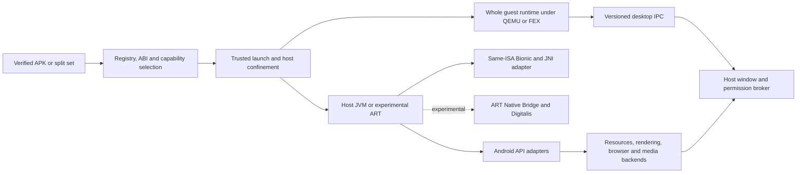

# Isakai research snapshot (frozen)

Reviewed on 2026-10-14 against `a354c60d279da75d04cd855b78d7e8fae9897111`.
Frozen: do not update this file. Corrections and current decisions go in the
owning task files and the live [delivery plan](PLAN.md). Anything here that
contradicts a task file is wrong; the task file wins.

## Research scope

Reviewed on 2026-10-14 against `a354c60d279da75d04cd855b78d7e8fae9897111`. Design rationale and research conclusions consolidated from the delivery review. Live status, blockers and acceptance evidence are in the individual task files. No upstream runtime was built during the research; estimates are planning ranges, not commitments.

Evidence grades distinguish direct local observations (E1), recorded project
UI evidence with stated limits (E2), inspected source/documentation (E3), and
proposed designs or unexecuted experiments (E4).

## CPU compatibility requires three distinct execution contracts


**DEX bytecode is not tied to an APK's ARM or x86 native slice.** A bytecode-only APK can in principle run on either host through a suitable runtime, but still depends on DEX features, libcore, resources and framework behavior. Host JNI bridges remain architecture-specific binaries. Once the APK includes native code, matching instruction set is only the first check: Android ABI also includes calling conventions, layout, TLS, dynamic linker behavior and platform libraries. For example, Android ARMv7 uses softfp conventions, while Android ARM64 reserves x18. ([NDK ABI guide](https://developer.android.com/ndk/guides/abis), [DEX specification](https://source.android.com/docs/core/runtime/dex-format))

| Linux host | APK native ABI | Eventual execution contract | Current support and independent gate |
|---|---|---|---|
| x86_64 | None | Host x86_64 JVM or selected DEX runtime | Existing route; only accepted workflows count. |
| AArch64 | None | Host AArch64 JVM/runtime plus rebuilt Isakai bridges | Needs real ARM64 hardware, packaging and confinement verification. |
| x86_64 | x86_64 | Same-ISA Bionic loader plus runtime JNI adapter | Current symbol subset is insufficient; prove Android-NDK-built libraries. |
| AArch64 | arm64-v8a | Same-ISA ARM64 Bionic/JNI route | Installer, paths, TLS and seccomp must change and pass on ARM64. |
| x86_64 | arm64-v8a only | qemu-aarch64 whole guest process first; mixed-ISA engine later | No current route. Requires matching guest runtime and bridge dependencies. |
| AArch64 | x86_64 only | Whole x86_64 process through QEMU; FEX accelerator, Box64 comparator | Reverse direction from ARM-on-x86; Bionic/JNI still required inside guest. |
| x86_64 | x86 | Separate 32-bit JVM/ART and libraries, native IA32 where available or qemu-i386 | A 64-bit JVM cannot load a 32-bit DSO. Independent i386 policy. |
| AArch64 | armeabi-v7a | Separate ARM32 runtime where AArch32 exists, otherwise qemu-arm | ARM64 does not guarantee ARM32 hardware/kernel/userspace. |
| x86_64 | armeabi-v7a only | qemu-arm whole 32-bit guest | Independent calling convention, dependencies, runtime and confinement. |
| AArch64 | x86 only | FEX whole x86 process or qemu-i386 | Box86 requires a 32-bit host subsystem; unsuitable for 64-bit-only hosts. |
| Either | Several slices | Select one complete compatible ABI; prefer native ISA and bitness | Never combine dependent libraries from different ABI directories. |

The first contract is **same-ISA Android/Bionic loading**. Isakai's current preload exports selected Android symbols, while `android_dlopen_ext` delegates to the host loader and ignores extension information. Bionic includes libc, libm, libdl and its Android dynamic linker; glibc is not a behavioral replacement. Bionic Translation already tackles loader, libc/pthread and TLS boundaries, making it a better experiment than expanding interposition indefinitely. However, `bionic_dlopen` alone does not register a library with HotSpot's native-method resolver. The adapter must handle symbol lookup, `JNI_OnLoad`, static JNI names, `RegisterNatives`, classloader ownership, callbacks, native-created thread attachment, exceptions, references/GC and lifetime. ART Standalone contains relevant runtime integration already. ([Bionic overview](https://android.googlesource.com/platform/bionic/+/refs/heads/main/README.md), [Bionic Translation](https://gitlab.com/android_translation_layer/bionic_translation/-/blob/6253dec7f24a57a94039a088cb436d880e92e3be/README.md), [ART JNI loader](https://gitlab.com/android_translation_layer/art_standalone/-/blob/66a5d9079b159e9c5819bfeef4a6fff6a5f32719/art/runtime/jni/java_vm_ext.cc))

The second contract is a **whole guest userspace process**. A guest JVM/ART, app libraries and guest-built Isakai bridge share ISA and bitness under QEMU user mode. A native supervisor brokers pixels, input, audio and permissions over versioned IPC/shared buffers. No host JNI pointer, `JNIEnv` table or function pointer crosses that boundary. This stays an ordinary Linux process without booting an Android OS or kernel. QEMU documents instruction, syscall and signal translation; it still needs the guest interpreter and libraries, and its limitations must be measured against JVM threads/signals and the host sandbox. With QEMU or FEX, seccomp evaluates syscalls made by the translator's **host executable**, rather than guest syscall numbers; direct i386/native processes need their own architecture policies. ([QEMU user mode](https://www.qemu.org/docs/master/user/main.html))

The third contract is **mixed-ISA JNI inside a host runtime**, the most difficult optimization. Guest ARM functions need signature-aware trampolines into host Java/native callbacks, guest loader and TLS, thread transitions, signals and safe pointer ownership. AOSP Native Bridge provides an interface, not the translator itself; linking it into HotSpot does not add ART's runtime hooks. Digitalis is a relevant public ARM64-to-x86_64 Berberis fork, but its shipped integration targets an AOSP host, with Android properties, fdsan, linker namespaces and JNI proxies. Evaluate it after a whole-guest correctness baseline, or stop if adopting it makes Android system services mandatory. ([Native Bridge README](https://android.googlesource.com/platform/art/+/refs/heads/main/libnativebridge/README.md), [interface](https://android.googlesource.com/platform/art/+/302ef33c94/libnativebridge/include/nativebridge/native_bridge.h), [Digitalis implementation](https://github.com/DigitalisX64/platform_frameworks_libs_binary_translation/blob/android-latest-release/native_bridge/native_bridge.cc))

The architecture should make these choices explicit:



The deployment rule stays **no Android OS image, Android system container or kernel Binder dependency**. A mount namespace that confines a host JVM is compatible with that rule; it is not an Android system container. Java Binder shells and libbinder/libgbinder do not supply ActivityManager, PackageManager, media services or Google services. Waydroid's full Android container, archived Anbox and Microdroid's protected VM are valuable reference/oracle environments, but changing to them would change the product architecture. ([Waydroid](https://waydro.id/), [Anbox archive](https://github.com/anbox/anbox), [Microdroid architecture](https://source.android.com/docs/core/virtualization/microdroid))

## Reuse deep implementations through narrow, owned adapters


The research supports selective reuse, rather than a language rewrite or wholesale classpath merge. Keep Zig installation, registry, signer continuity, process supervision, per-app data ownership and isolation. Keep current SQLite and working desktop/audio paths until measured limits justify replacement. Give each Android-facing class one owner; placing two full `android.*` frameworks on a classpath creates incompatible ownership and behavior. Every candidate below is E3 source evidence and an E4 adoption recommendation, not a built Isakai dependency.

| Component | Reuse recommendation and boundary | Main limit and promotion gate |
|---|---|---|
| ATL | Port focused pure-Java/AOSP algorithms and study its native assets/window/service adapters. | GTK/GDK/GLib object ownership differs from Isakai's raw Wayland SHM path; its README acknowledges missing APIs and sandbox work. No wholesale replacement. |
| ART Standalone | Bounded alternative DEX/libcore/JNI backend; study existing Bionic and Native Bridge integration. | Current framework uses Java2D/AWT, host image APIs and `Path.of`. Porting it requires API/build/render adaptation, rather than changing `java` to `dalvikvm`. |
| `libandroidfw` | JNI/C adapter below Resources/AssetManager for configuration selection, themes, assets and binary XML. | Native dependencies and handle ownership; preserve verified original APKs and define framework/system resources. Compare locale/density/night/SDK selection. |
| Robolectric 4.17 + Simulator | Compare instrumented Android implementation JAR/shadows with current framework; retain as oracle if unsuitable. | Simulator is explicitly experimental and documented for source/test apps, not arbitrary installed APKs. Must prove dex2jar APK loading, Linux ARM64 binaries and isolation. |
| dex2jar 2.4 | Compare install-time DEX conversion against current translator; include tool/input hashes in cache identity. | Compiler substitution does not provide Android framework or native ABI support. Verify complete multidex output and real workflows. |
| Bionic Translation | Preferred same-ISA loader/wrapper spike; reuse upstream fixture coverage. | Needs main-executable/TLS work and runtime JNI resolution; non-null `android_dlextinfo` remains unimplemented upstream. |
| [libhybris](https://github.com/libhybris/libhybris) | Targeted wrapper/loader reference if an actual app dependency fits. | Hardware-adaptation focus, per-driver bridges and Bionic assumptions; neither CPU translator nor full app framework. |
| QEMU user mode | Whole-guest correctness baseline in both CPU directions, with ARM32 separate. | Performance, guest runtime footprint, signals, clone behavior and sandbox integration require measurements. |
| [FEX](https://github.com/FEX-Emu/FEX/blob/main/Readme.md) / [Box64](https://github.com/ptitSeb/box64/blob/main/README.md) | Compare x86/x86_64 processes on ARM64; FEX first, Box64 secondary. | Wrong direction for ARM APKs on x86_64. Host API wrappers do not implement Bionic/Android. |
| [Digitalis](https://github.com/DigitalisX64/digitalis/tree/android-latest-release) / [upstream Berberis](https://android.googlesource.com/platform/frameworks/libs/binary_translation/+/refs/heads/main/README.md) | Time-box correct-direction Digitalis mixed-ISA experiment; reuse public proxy/JNI patterns. | Public upstream Berberis README documents RISC-V64 guest support; Digitalis adds ARM64. Android-host integration is not a validated glibc/HotSpot plugin. |
| AOSP [apksig](https://android.googlesource.com/platform/tools/apksig/+/refs/heads/main/README.md) / [bundletool](https://developer.android.com/tools/bundletool) | Public Java verifier and existing split-selection tooling; keep registry/update policy in Isakai. | Atomic package/version/signer/resource/classpath validation remains custom. Preserve signatures; never silently debug-sign someone else's bundle. |
| AOSP/Layoutlib + Skia | Port selected host framework delegates; put CPU SkSurface behind Canvas/Paint/Bitmap before GPU. | Layoutlib is a preview system; real lifecycle/input/Compose are separate. Use shared shaping/metrics for measure, draw and selection. |
| Mesa / ANGLE | Packaged EGL/GLES/Vulkan backend after Android native-window ownership exists. | Current wire IDs are not `wl_display*`, `wl_surface*` or EGL handles. Establish libwayland/GDK object boundary first. |
| CEF/JCEF or WebKitGTK | Real WebView backend behind Android API adapter and per-app browser process contract. | JavaScript bridge, origin policy, profile isolation, callbacks and browser sandbox remain substantial; CEF ARM64 availability unverified here. |
| GStreamer / FFmpeg / PipeWire | Asynchronous bounded streaming/decoding and authorized host audio/video endpoints. | Decoder success is not MediaCodec or DRM compatibility. Keep per-API state/callback semantics and codec license review. |
| Portals / optional sandbox tools | Broker FileChooser/OpenURI/notifications/location/camera using per-app identity and authorized fds. | Bubblewrap supplies plumbing, not policy; broad session-bus access or disabled browser sandbox fails the boundary. |

ATL's source uses ART plus Bionic Translation, native libandroid adapters and GTK; it is the closest useful reference to Isakai's premise. Its resource C API exposes APK loading, configuration, lookup, reference/theme/style and XML functions. Those can be evaluated independently of replacing DEX execution. Current `Resources.lookupDepth` prefers a default or first type chunk rather than implementing complete Android best-match resolution; `src/arsc.zig` adds a second parser. Replace the deep selection engine once, with a compatibility facade for the label reader, instead of accumulating two implementations. APK-backed assets also require preserving an immutable verified archive or proving a staged-assets adapter, including native fd/offset semantics. ([ATL build](https://gitlab.com/android_translation_layer/android_translation_layer/-/blob/07c34abad5d29864998ed7c7cfc6c80d0765b9df/meson.build), [resource C API](https://gitlab.com/android_translation_layer/art_standalone/-/blob/66a5d9079b159e9c5819bfeef4a6fff6a5f32719/libandroidfw/include/androidfw/androidfw_c_api.h))

ART and Robolectric answer different costs. ART removes bespoke DEX execution and brings Android-oriented JNI/libcore integration, but forces a host-only API/render audit. Robolectric is closer to the present JVM and supplies actual Android implementation plus instrumentation/shadows, yet its simulator remains proof of concept. Loading `android-all.jar` beside existing classes does not reproduce Robolectric initialization or native/service handling. Run a 2–5 engineer-day ART build/DEX/JNI spike and a 5–10 engineer-day Robolectric source-app-then-same-APK spike; choose one strategic backend from actual fidelity, maintenance, memory/startup and confinement results. Preserve the existing JVM path until the challenger completes the same workflow. ([ART Standalone README](https://gitlab.com/android_translation_layer/art_standalone/-/blob/66a5d9079b159e9c5819bfeef4a6fff6a5f32719/README.md), [Robolectric architecture](https://robolectric.org/architecture/), [Simulator](https://robolectric.org/simulator/), [dex2jar release](https://github.com/pxb1988/dex2jar/releases/tag/v2.4))

For rendering, reuse Skia and established Unicode libraries instead of expanding independent raster, shaping and line-breaking engines. A small C ABI can wrap SkCanvas/SkSurface while existing Java APIs retain ownership. Start with CPU buffers and unify measurement, drawing, cursor placement, selection and fallback. HarfBuzz, FreeType and ICU are candidate constituents; Arabic, Indic, Tibetan, bidi, combining sequences and emoji need visible corpus coverage. GPU work requires Android `ANativeWindow`, surface/configuration/lifetime and synchronization semantics; linking EGL alone cannot supply them. ([Skia documentation](https://skia.org/docs/), [HarfBuzz](https://harfbuzz.github.io/), [Mesa EGL](https://docs.mesa3d.org/egl.html), [ANGLE](https://github.com/google/angle/blob/main/README.md))

F2 should embed an actual browser. CEF offers offscreen rendering and JCEF integration references; WebKitGTK offers maintained distro integration and script-message APIs. Prototype the required APK page, JavaScript calls and lifecycle before choosing. ATL's WebView is a useful host-backend reference but its inspected `evaluateJavascript` is empty and its bridge contains an app-specific shortcut. F1 should adopt bounded asynchronous media pipelines, not whole-file decode as the general path. F4 should retain unavailable-provider behavior until a brokered real provider exists; fabricated coordinates remain test-only. ([CEF](https://github.com/chromiumembedded/cef/blob/master/README.md), [WebKitGTK bridge](https://webkitgtk.org/reference/webkitgtk/stable/class.UserContentManager.html), [ATL WebView](https://gitlab.com/android_translation_layer/android_translation_layer/-/blob/07c34abad5d29864998ed7c7cfc6c80d0765b9df/src/api-impl/android/webkit/WebView.java), [GStreamer playbin3](https://gstreamer.freedesktop.org/documentation/playback/playbin3.html), [portal Camera](https://flatpak.github.io/xdg-desktop-portal/docs/doc-org.freedesktop.portal.Camera.html))

## Ship a measured support promise with controlled maintenance


A feasible sequence begins with **weeks 1–3 for honest acceptance oracles, missing privileged fixture, current app blockers and reproducible evidence**, then a 1–2-week bounded reuse decision period. N2/N3/N4 and resource/native pilots can follow in delivery slices; native ARM64 comes after the same-ISA contract is meaningful, and foreign ISA follows a guest boundary. For a single maintainer, a narrow, well-proven x86_64 plus native ARM64 utility release is a **multi-month effort**, with an illustrative 3–6-month planning envelope if the small runtime spikes pass. This is not a commitment: deeper Compose, ART migration, graphics or unavailable ARM hardware can expand it substantially. ARM64-on-x86 and reverse-direction acceleration add their own pilot budgets; broad 32-bit/native games/WebView/media coverage is later. With two specialists, runtime research and app verification can overlap, but do not maintain ART and Robolectric production forks simultaneously before choosing.

Use four release decisions. First, all current pinned tasks pass under default isolation with clean restart and signer/upgrade behavior. Second, both native host architectures reproduce those exact tasks and the same-ISA NDK corpus. Third, a foreign-ISA backend passes a separately named corpus and publishes overhead/limitations. Fourth, new capability families enter only with motivating apps and maintenance owners. Measure cold/warm launch, translation time/cache hit, RSS/PSS, idle CPU, frame-time distribution, input latency, fd/thread counts, child cleanup and installed/download size. Initially publish measurements, then choose realistic budgets; neither upstream demos nor this audit provides performance numbers. A mixed-ISA optimization must beat the whole-guest baseline reproducibly on useful work, not just start an ELF.

Product success means retained useful workflows, not source count. Track supported app versions per host/APK ABI, percentage of previously supported flows that still pass, blocker diagnosis turnaround, reproducibility from clean machines, security-update lag and upstream patch burden. A small weekly expansion into ordinary Kotlin/Java utilities gives clearer value than hundreds of silent API shells. Add Compose-heavy, browser and native media apps as explicit capability cohorts. “Installed,” “ELF compatible,” “loader/JNI verified,” “window mapped” and “useful task accepted” must remain separate results.

Pin the initial research candidates before building: ATL `07c34abad5d29864998ed7c7cfc6c80d0765b9df`, ART Standalone `66a5d9079b159e9c5819bfeef4a6fff6a5f32719`, and the previously inspected Bionic Translation `6253dec7f24a57a94039a088cb436d880e92e3be` are source-review starting points, not a claim of newest or compatible combined builds. Robolectric `4.17` and dex2jar `v2.4` were verified release tags; dex2jar's release date is 3 October **2023**. Capture immutable Digitalis/manifest/subproject hashes before its experiment. The discovered `killerdevildog/android_translation_layer` unified CMake wrapper at `4ed75fbf108c5593a65b6ee1295d5445c935aaf4` is real, but hardcodes an amd64 JDK, copies lib64, masks failures with `|| true` and assumes external sources. Reuse its build ordering only after correcting portability/failure propagation; prefer official Meson/local-prefix recipes initially. ([ATL build guide](https://gitlab.com/android_translation_layer/android_translation_layer/-/blob/07c34abad5d29864998ed7c7cfc6c80d0765b9df/doc/Build.md), [CMake wrapper](https://github.com/killerdevildog/android_translation_layer/blob/4ed75fbf108c5593a65b6ee1295d5445c935aaf4/CMakeLists.txt), [Robolectric release](https://github.com/robolectric/robolectric/releases/tag/robolectric-4.17))

Licenses need component-level decisions. Isakai is GPL-3.0-or-later; ATL has GPLv3 plus retained AOSP notices. ART/Bionic contain mixed files/dependencies; an inspected Apache notice cannot license their whole tree. apksig, Robolectric, dex2jar, bundletool and Digitalis have Apache-2.0 evidence for their reviewed entry components; verify every imported subtree. QEMU is GPLv2; FEX/Box64 core MIT; libhybris is mixed. Skia/ANGLE/CEF principal code uses BSD-style terms, HarfBuzz principally Old MIT, FreeType FTL or GPLv2, ICU Unicode License V3 plus notices, WebKit mixed LGPL/BSD. GStreamer core is LGPL-2.1; FFmpeg depends on enabled components and build flags. Record source/license hashes, build flags, transitive notices, patches, source-offer requirements and an update owner. No proprietary Houdini/libndk_translation redistribution permission was established; a mirror download is not product permission. ([AOSP licensing](https://source.android.com/docs/setup/contribute/licenses), [Skia license](https://github.com/google/skia/blob/main/LICENSE), [WebKit licensing](https://webkit.org/licensing-webkit/), [FFmpeg legal](https://ffmpeg.org/legal.html), [QEMU documentation](https://www.qemu.org/docs/master/user/main.html))

Scope excludes any universal banking, anti-cheat, protected streaming or Google-service promise. Android compatibility formally involves CDD/CTS, and Google licensing is separate. Play Integrity device verdicts rely on certified Android and hardware-backed conditions; a Linux compatibility process should not fabricate attestation. A codec engine does not supply DRM plugins/device provisioning. Network/service authentication, proprietary hardware APIs, vendor camera stacks and downloaded native code remain app-specific unknowns. State these in the matrix before users invest in unsupported applications. ([Android compatibility](https://source.android.com/docs/compatibility/overview), [Play Integrity verdicts](https://developer.android.com/google/play/integrity/verdicts), [Android DRM architecture](https://source.android.com/docs/core/media/drm))

The next three execution commands, from the repository root, are below. They exercise the existing path; they do not build the proposed upstream stack. The final command currently requires the private Sway/vinput fixture and installed pinned Calculator work tree, so N1 must make that setup portable; the report command needs only the pinned APK and built framework. Record the exact environment and retain a separate evidence directory per run. A Calculator failure is useful evidence for C6, not a successful release gate; final default-privileged reruns follow after these development diagnoses.

```sh
zig build
python3 tools/compat-report.py .cache/isakai/apks/calculator-fdroid-release.apk --output /tmp/isakai-calculator-compat.json
python3 verify-isakai/sway-flow.py calculator --work .cache/isakai/recheck/calculator2 --evidence /tmp/isakai-calculator-audit-ui
```


The next architectural decision should be purchased with a small complete experiment: a verified APK, real JNI or resource semantics, a visible useful action and confined shutdown. That evidence will reveal whether reuse truly removes maintenance or merely moves it into a fork. Isakai can become a useful compatibility product by defending that decision boundary at every expansion; no single imported runtime can turn a partially implemented Android API into universal application support.
